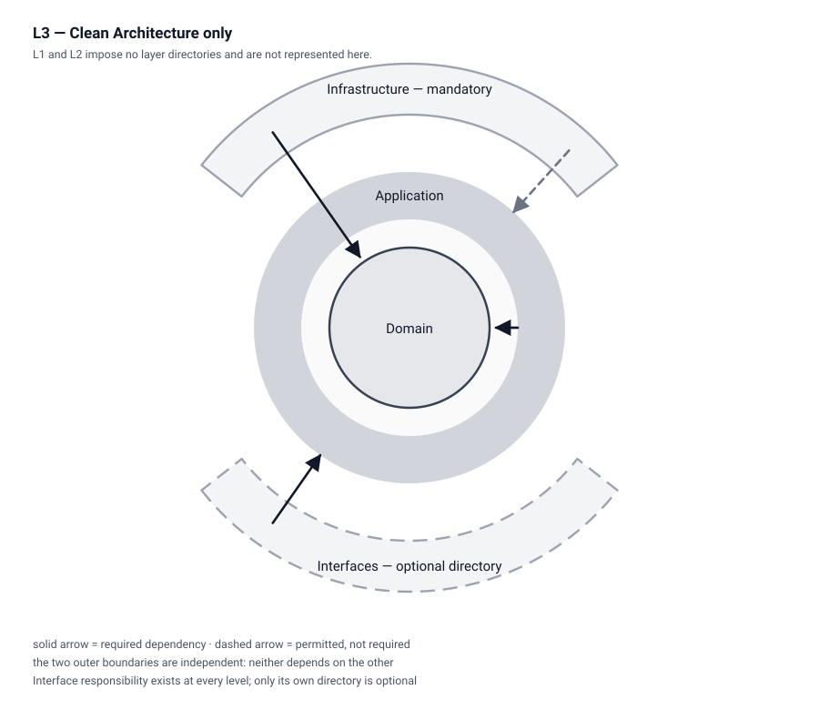
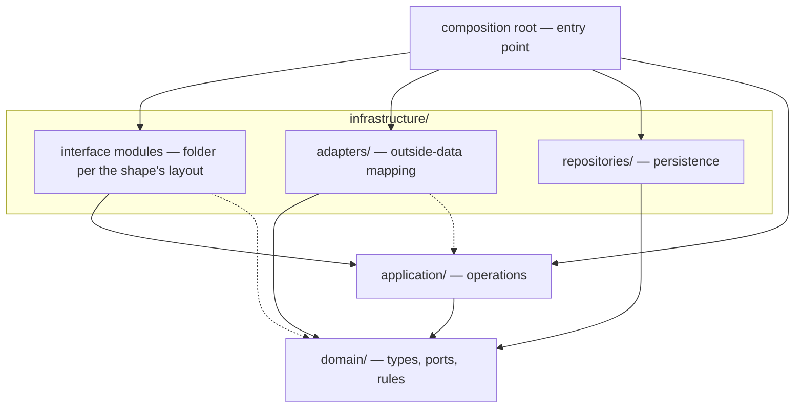
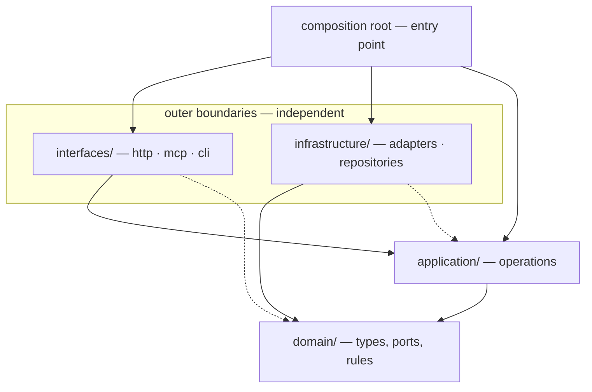

# Clean architecture

## Purpose and authority

Statement-layer ownership is defined in `.aicore/core/architecture/README.md` → `## Content model`. These are intended architecture decisions, not evidence that existing code conforms. Documentation approval and implementation verification are separate.

## C1 — Layers and dependencies

The same layers apply across languages: domain, application, infrastructure; static dependencies point inward, infrastructure → application → domain. A language or library is never a layer and cannot suspend this contract. Shape-specific folders bind these responsibilities without renaming the layers. The application imports only domain types and ports, never frameworks or concrete adapters. Runtime effects through injected domain ports are allowed: a runtime call graph is not the static-import graph. These obligations bind where a project's selected complexity level requires the layers (`C11`); at L1 and L2 no layer, folder or inward-dependency obligation arises, and the responsibilities this contract names bind only where they exist.

## C2 — Domain and ports

Domain imports no framework or infrastructure. Entities and typed ports speak domain types, not raw external records. Domain business errors carry stable codes and messages. Concrete entity representation and port syntax belong in the selected shape/stack guide.

Entity representation and state changes follow C8; data-only records and functional domain modules remain distinct valid representations.

## C3 — Application operation

**At L3 (`C11`).** Each application operation is one named business operation exposing a single `execute()`, depends on injected domain ports rather than concrete IO, and is a class in every language: a standalone function never stands in for an L3 operation, however small it is. The class receives its required collaborators through constructor injection. One operation per module or file; its name states a business outcome, and `Service`, `Manager`, `Helper`, `Processor`, and `Util` are not operation names. A composition root or CLI router may wire several operations but must not re-declare an operation class. Enduring invariants and legal transitions belong in the domain, and application-specific orchestration may stay in the operation.

**At L1 and L2 (`C11`).** No operation form is imposed. A named business operation may be a function, a module, or a class chosen for the code's own clarity, and it acquires no class, `execute()`, constructor-injection, one-per-file, naming or composition-root obligation from the L3 rule. A level is never applied recursively: within an L3 project, pure helpers, local functions, a one-off auxiliary script and a small utility module remain ordinary code (`C7`) and carry no layer folder or operation class.

**At every level, wherever the responsibility exists.** Class-first never licenses abstraction for its own sake: add no base class, interface, inheritance hierarchy, forwarding service layer or pass-through wrapper without a real polymorphic or behavioural need, and a helper, utility or other module-level function that is not an application operation stays a function. Presentation components, hooks and general-purpose utilities are not application operations and are not made classes by this rule. Business policy belongs to the operation or the domain, never to an adapter, a presentation component or an interface handler (`C4`, `C12`); adapters hold no business policy.

**Domain-model classification, at every level where a domain exists.** Data-only boundary and result records and functional domain modules remain valid representations. A data-only record is anemic only when it claims to be the domain model while allowing public mutation and its rules are enforced elsewhere.

## C4 — Mapping and composition

Adapters map outside data to domain data through a single mapping/parsing step and contain no business rules. Composition supplies concrete adapters to use cases only at the edge.

The split between domain and infrastructure is decided by who owns the rule, not by the fact that data changes shape. A transformation that is itself a business rule — the rule that decides the outcome — belongs in the domain; application-specific orchestration that applies such a rule stays in the use case (C3). A transformation between an external representation and domain data — a persistence record, a transport payload, a third-party response — belongs at the infrastructure boundary that owns that representation. Neither side hosts the other's rule, and infrastructure-specific mapping never enters a domain entity.

## C5 — Failures

A business failure is a typed domain error returned as a value, never thrown by the business operation. Boundary exceptions (framework/transport) and programming exceptions (including IO crashes) remain exceptions; do not fabricate domain errors from arbitrary caught exceptions or impose exception-as-result wrappers. A documented business-failure response may be mapped to the corresponding domain error. Presentation may bind returned business errors and propagated exceptions to its error channel without reclassifying them.

## C6 — Serialization

Business operations consume and return domain types. Transport serialization belongs to the delivery edge (controller/handler/view), never inside `execute()`.

## C7 — Pure helpers

A pure helper needs no artificial use-case wrapper. A module that decides policy and calls infrastructure does need the application-operation boundary.

## C8 — Domain model and legal change

Classify a type by identity, equality, invariant ownership, legal transitions and effects, not its name or the presence of a class declaration:

| Kind             | Classification and obligations                                                                                                                                                                                                                                                                                                                                                |
| ---------------- | ----------------------------------------------------------------------------------------------------------------------------------------------------------------------------------------------------------------------------------------------------------------------------------------------------------------------------------------------------------------------------- |
| Entity           | A class whose stable identity distinguishes instances even when attributes coincide. Its behavior protects enduring invariants and legal changes; a factory creates a valid instance. No public setters or writable identity. A child entity may delegate enforcement to its aggregate root, but no supported child access or construction may bypass that root's invariants. |
| Value object     | No independent identity; equality is by constituent values. Immutable and valid at construction, including nested state. Changes produce another valid value.                                                                                                                                                                                                                 |
| Aggregate        | Where used, a consistency boundary containing a root entity and its owned parts. The root is the only mutation entry point and enforces cross-part invariants; other aggregates are referenced by identity, not mutable object ownership. A root alone can form an aggregate.                                                                                                 |
| Domain event     | Where used, an immutable fact already produced by successful domain behavior, with immutable payload. It is not a command, transport envelope or integration message.                                                                                                                                                                                                         |
| Domain service   | Domain behavior without a natural entity/value-object owner. Uses domain types and owns domain policy, not application orchestration or concrete IO. It does not provide an escape hatch for moving an entity's invariants to callers.                                                                                                                                        |
| Pure rule module | Cohesive, IO-free domain functions named for their predicate or business calculation. Needs neither artificial entity state nor a service/use-case wrapper (C7).                                                                                                                                                                                                              |
| Data-only record | Typed data without a claim to own identity-based behavior or legal transitions. Domain records and read projections are framework-free; storage and transport records belong outside domain. Mutability is determined by the record's use, not an entity label.                                                                                                               |
| Port             | A domain-owned typed contract for an external capability, expressed in domain types; implementation is outside domain. Repositories, query capabilities, clocks and other service contracts are distinct port roles. A port declaration performs no IO.                                                                                                                       |
| Domain error     | A typed expected business rejection with stable code and message, returned as a value (C5); not a wrapper for unexpected exceptions.                                                                                                                                                                                                                                          |

Entities and value objects may contain public or private methods for domain behaviour, invariant enforcement, business transformations, and domain-native state access. They must not contain methods that map to or from external representations, including JSON or transport payloads, database rows, ORM models, or third-party schemas. Such mapping belongs to the infrastructure adapter or delivery boundary responsible for that representation (C4, C6).

For an entity transition, a named behavior checks the requested change and returns a new valid instance with the same identity or a typed domain error value. The original remains unchanged. Protect the entire owned graph: nested mutable collections, child objects and exposed aliases must not permit caller mutation of either version. Read-only field declarations alone are insufficient. A child may have no separate transition method when its root performs the change and enforces its invariants; this is explicit root ownership, not application-owned rules.

Creation establishes identity and creation eligibility. Reconstitution restores persisted identity and validates applicable state invariants, not today's creation eligibility; it must not replay creation events or effects. Invalid persisted state is unexpected corrupt data, not a business rejection and not permission to coerce state silently (C5). Construction paths and accessors must preserve these protections.

Where events are used, successful behavior carries pending immutable facts on the returned aggregate in an immutable collection with immutable elements; a failed transition creates no success fact. Domain behavior never publishes them. Reconstruction starts without replayed creation facts. Publication and transaction coordination follow C9.

Review asks: which behavior enforces each invariant; which transitions are legal; how are identity, children and nested aliases protected; can construction or exposed data bypass enforcement? Getters and a factory alone do not answer these questions. A publicly mutable domain-named bag with rules in its callers is a record if intentionally data-only, otherwise a nonconforming model, not a compliant entity. Do not invent aggregates, events or rich classes for CRUD, records or pure calculations that do not use them.

## C9 — Repositories, projections and transactions

A repository is a collection-like persistence port for one aggregate-root type, not one instance, table or child. Where aggregate persistence is used, define one repository port per root type; children are loaded and saved through their root. It accepts/returns domain objects and identifiers; absence is an empty lookup result, never an exception. Application policy decides whether absence is a business error. A repository has no business policy and performs no commit. Its infrastructure adapter maps persisted state to a valid reconstituted domain object through the explicit C4 mapping step.

A query port may instead return framework-free, domain-owned read projections without rehydrating aggregates. A projection describes a read use case, not storage layout or transport serialization (C1, C6). Other capability ports need not pretend to be repositories. No port leaks rows, ORM models or delivery payloads. Only explicitly contracted persistence conflicts may map to corresponding typed expected outcomes; arbitrary IO, mapping or corrupt-data exceptions retain C5 semantics.

The application coordinates the atomic transaction scope and commit/rollback across involved ports; infrastructure supplies the transaction mechanism. An optional domain-owned unit-of-work port may expose that capability when needed; an existing session/transaction facility may suffice. Never hide commit in a repository or require a custom unit-of-work abstraction. For immutable transitions, explicitly persist the returned replacement; ORM tracking of the unchanged original is not persistence of the new state.

Coordinate successful persistence with event publication outside domain so a failed transaction does not publish success facts. Publishing after commit is ordering, not guaranteed delivery: where reliable delivery is required, specify the persistence/publication strategy and failure handling. No bus, outbox or universal delivery mechanism is mandated. Test doubles remain governed solely by the testing contract.

## C10 — Semantic concept-role naming

Use a business concept plus its actual role, with one shared vocabulary. Classes keep business names such as `Order`, not `OrderEntity`. Shapes own folder placement; guides own language filename syntax. The semantic roles below apply across languages; do not add redundant technical suffixes such as repository-interface or entity-model.

| Role           | Concept example and meaning                                                                    |
| -------------- | ---------------------------------------------------------------------------------------------- |
| entity         | `Order`: identity-bearing model                                                                |
| value object   | `ShippingAddress`: identity-free value                                                         |
| event          | `OrderPlaced`: produced domain fact                                                            |
| repository     | `OrderRepository`: aggregate persistence contract/adapter, distinguished by layer              |
| port           | `Clock`: other capability contract                                                             |
| domain service | `Pricing`: actual ownerless domain behavior                                                    |
| policy         | `PricingPolicy`: an actual business policy, not a label for every pure function                |
| error          | `OrderClosed`: expected business rejection                                                     |
| row            | `OrderRow`: raw persisted shape, infrastructure-owned                                          |
| model          | `OrderModel`: persistence/ORM model, infrastructure-owned; never a generic domain model bucket |
| request        | `CreateOrderRequest`: action-specific inbound delivery payload                                 |
| response       | `OrderResponse`: outbound delivery representation                                              |
| projection     | `OrderSummary`: framework-free domain-owned read shape                                         |
| record         | A concept-specific intentional data record where no more precise role applies                  |
| query          | A concept-specific read capability port                                                        |

Pure functions/modules use the predicate or business calculation they express, without fabricated entity/service roles. Apply roles only to artifacts actually needed; do not create unused requests, wrappers or records to fill a naming table. Boundary records do not become domain-owned because they mention a domain concept: rows/models stay in infrastructure, request/response shapes at delivery. Each maps explicitly to/from domain data under C4–C6, never passing as the domain entity itself.

## C11 — Architecture complexity level

A project selects one level. The level decides whether a layout is mandated; it never removes a responsibility that exists.

- **L1 — Simple.** One focused responsibility, with no rule that more than one entry point must obey and no boundary that must be protected from the rest of the code. No `domain/`, `application/` or `infrastructure/` layout is required or implied. Functions and modules are the normal representation. No port, adapter, repository, container, base class or wrapper without a demonstrated need. A script that reads inputs, transforms them and writes results is an L1 artifact however many file, process or network operations it performs, and needs no application class, port, repository or injection to be compliant.
- **L2 — Modular.** Several cooperating responsibilities. Modules are named for their responsibilities and split only for a practical reason. No layer tree is manufactured. A dependency rule binds only the directions the modules actually have.
- **L3 — Clean Architecture.** `C1`–`C10` bind in full, including the canonical layer layout and the L3 operation form of `C3`. The Interface boundary of `C12` may additionally be extracted under `C13`.

**Universal obligations — bind at every level, in proportion to whether the responsibility exists.** The separation of an external entry edge from the work it triggers (`C12`); one mapping step at any boundary and no business rule in boundary code (`C4`); expected business failures returned as values and unexpected exceptions left as exceptions (`C5`); no transport serialization inside a business rule or operation (`C6`); pure helpers need no wrapper (`C7`); `C10`'s naming roles for the artifacts that actually exist.

**Selection is evidence-based, not scored.** No count of lines, files, business operations, external effects, dependencies, transports or tests selects a level, and no project type automatically selects L3. The deciding question is one: does a boundary need protecting from the rest of the code? Any single one of the following is sufficient on its own, at any project size, when it is material:

- a business rule that must hold across more than one entry point;
- a capability that must be replaceable behind a contract;
- a coordination or atomicity requirement that must be enforced in one place across more than one effect;
- an external boundary whose failure must be classified rather than leaked;
- a delivery channel expected to change independently of the rules;
- a published contract whose consumers must not depend on transport or storage.

None of them justifies L1 or L2 in a project of any size. Where the evidence is genuine but marginal, choose the lower level and record the reason: upgrading is a separately authorized change, never automatic.

**Granularity.** The level is selected for the project and governs its principal boundaries. It is not applied recursively: within an L3 project, pure helpers, local functions, a one-off auxiliary script and a small utility module remain ordinary code and carry no layer folders or operation classes (`C7`). A level decided for a repository never forces a new folder onto a component whose responsibility does not exist.

**Independence, recording and boundaries.** The level is independent of application shape and language. Architecture classification is a working judgment, not a documentation obligation. A project-level architecture record is required only when the project makes a real project-level architectural decision — selecting L3, authorizing an interface extraction under `C13`, or changing an existing approved architecture. An L1 script or utility needs no new document, record, approval step or review gate; its classification is recorded only where the project already keeps such notes, and its absence is never a defect. Existing approved project architectures are preserved: changing one is a separately authorized change with its own record, and this rule mandates no migration and adds no enforcement tooling.

## C12 — Interface boundary

**Existence.** The Interface boundary is the set of responsibilities that translate between an external interaction channel and the work the program performs. It exists in every project with an external entry edge — a script's argv and exit status, an HTTP route, an MCP tool, a CLI command, a UI event, a game-input frame. At L1 it is usually the entry file itself. Its existence never implies a folder.

**Owns.** Channel input parsing and channel-specific validation; one mapping step between channel payloads and the parameters the program's work receives (`C4`); delegating that work; binding its outcome — a returned result or a returned business error — to the channel's response or error mechanism; channel-specific serialization (`C6`); channel metadata such as session or auth identifiers, read without a business rule.

**Delegation, not implementation.** A handler delegates the business behavior it triggers and never implements it. It may invoke one operation or several, and may sequence them when each is independently complete; what it must not do is hold the decision. A sequence whose ordering, conditions or error handling constitutes a business rule is itself business behavior and belongs in an operation at L3 or in a named function or module at L1 and L2 — never inlined in the handler. Repeating coordination logic that an operation already owns is the same defect as reimplementing its rule.

**Dependencies are architectural, not technological.** This contract governs dependencies between the components of the architecture. It does not prohibit external libraries. A component may use the third-party libraries its own technology requires, provided their use does not breach an architectural boundary.

**At L3.** A handler's architectural dependencies point inward and only inward: it imports application and domain modules, never a persistence adapter, repository implementation or infrastructure IO helper of this project. It may use the transport framework, SDK, schema validator, serializer or other library its channel requires; those are technical dependencies, not edges into the architecture. Where it needs a capability the project owns, it reaches it through an application operation. An infrastructure adapter is symmetric: it may use external clients, drivers, storage libraries and infrastructure-owned utilities of this project, depends inward on domain modules, may depend on application modules only where its port requires it, and never imports an interface module. Neither may use a technical library to implement business behavior: invoking a driver or SDK directly to decide an outcome is the same defect as holding the rule.

**At L1 and L2.** A handler may orchestrate external effects directly — read a file, call a service, write output — using whatever libraries the work needs, because no application layer exists to delegate to. The obligation that survives is the separation of the decision from the effect: the rule that decides the outcome lives in a function or module the handler calls, not fused into the effect code, so the decision can be read and verified without the effect. No boundary inversion, port, adapter or injection container is required by this rule, and no additional file, class or wrapper is required for a trivial script.

**Composition.** Constructing a collaborator that crosses an architectural boundary happens only at the designated composition root. An adapter or a handler may construct its own technical helpers; it does not construct the project's concrete adapters, repositories or operations.

**At every level.** Business policy does not live in interface code; a framework request or response object does not enter domain or application code (`C2`); a transport payload is not serialized inside a business rule or operation (`C6`); no level justifies mixing the two.

## C13 — Interface placement and extraction

**Placement is shape-owned.** The shape names where the Interface responsibility lives in that shape's layout. Physical extraction means moving those modules into an independent folder at the same level as the layer folders. It is optional, separately authorized and never automatic. The absence of such a folder is never a defect.

**Canonical name.** When an independent Interface folder is explicitly authorized, it is named `interfaces/` and holds channel-specific modules beneath it (`http/`, `mcp/`, `cli/`). A project that already carries an approved differently-named interface folder — a project-specific `delivery/` or a channel-named `mcp/` — keeps it: renaming it is a migration, not a conformance requirement.

**At L3, independence precedes extraction.** While interface modules and infrastructure adapters share the infrastructure layout, they remain independent boundaries: interface modules depend inward on application and domain modules, adapters depend inward on domain modules and may depend on application modules only where a port requires it, and neither imports the other. Co-location never licenses an interface module to reach a persistence adapter, and extraction is never required to obtain that independence.

**After extraction.** Interface modules and infrastructure adapters are sibling outer boundaries, each depending inward independently: interface modules depend inward on application and domain modules, adapters depend inward on domain modules and may depend on application modules only where a port requires it, and neither imports the other. The composition root depends on both. Technical libraries remain permitted on both sides under `C12`.

**Invariant.** Extraction changes no application operation, domain type or port: the same signatures and the same inward imports, at a different path. A change that redesigns domain or application in order to extract is not an extraction; it is a separate redesign requiring its own authorization and evidence, and the original extraction may not be used as its pretext.

**Evidence required.** Extraction is considered only on an evidenced maintenance or dependency-boundary problem: a `C12` violation the co-located layout keeps inviting; transport mapping that has become the principal change surface and no longer keeps one mapping step; channel validation or serialization that cannot be reasoned about in isolation; an interface that needs an independent release or test boundary its location prevents; several handlers accumulating shared transport-specific behavior with no owner. No count of channels or files is evidence, and none of these is an automatic trigger. Without such evidence the interface stays where the shape puts it.

**Authorization.** No agent creates, renames or migrates an interface folder without an authorized change.

## Diagrams

`.aicore/core/architecture/implementation/architecture-boundaries.svg` is the L3 structure; the two figures below are its physical deployments. All three are illustrative and carry no rule the sections above do not state.

**Scope.** The circular figure depicts L3 only (`C11`). L1 and L2 impose no layer folders, and the figure is not their layout. It shows architectural responsibility, never directory placement: no folder name appears in it.

**Reading the dependencies.** A solid arrow is a required dependency and a dashed arrow is permitted but not required. Infrastructure's required dependency points at Domain; the Infrastructure-to-Application edge is permitted only, because an adapter implements a domain port without importing the application layer. The two outer boundaries are siblings and carry no dependency between them in either direction.

### Three-layer deployment

Interface modules live inside the infrastructure layout, isolated from the adapters that share it.

`IF` carries the Interface responsibility of `C12`; its folder name belongs to the shape. Solid edges are required and dotted edges are permitted. `IF` shares a parent folder with `AD` and `RP` and imports nothing from either (`C13`).

### Extracted-interface deployment

No edge connects `IF` and `INF` in either direction: they are sibling outer boundaries that each depend inward (`C13`).

**When to consult them.** Choose or review a project structure against the circular figure; place or move interface code against the matching deployment figure. A figure never overrides the rule text, and an existing project's approved structure is not redrawn to match one.

## Testing and execution

The current test-design authority is `.aicore/core/architecture/testing/architecture.md`, with its selected stack guide. It alone owns test levels, organization, doubles, evidence, and test-guide parity. Agent runtime specs own execution authority, edit scope, checkpoints, review procedures, and uncertainty routing. This document grants none of those permissions.
