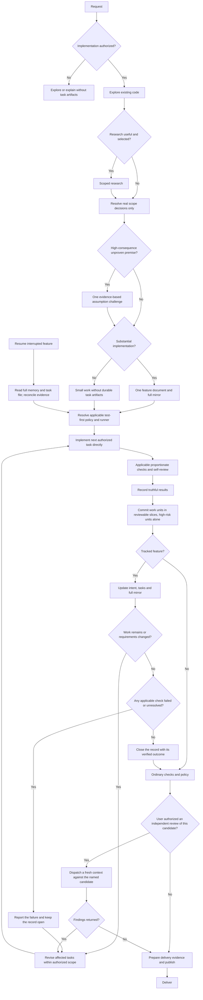

# Agent workflow

Read this entry before acting. ODD is the governing workflow: read-only and small work create no durable feature artifact. For authorized non-small state-changing work, creating the governing feature document from its template is the sole authorized bootstrap write; no other mutation precedes it. Revise an existing document before affected work resumes and apply decision-only stops. This entry routes work; it does not grant authority, replace an owner procedure, or prove delivery.

### Canonical ODD flow

The supplied diagram is preserved with its operational interpretation below. Vendor labels describe capabilities, not installed commands. Written alignment, observed scenario execution and unverified runtime behavior are separate evidence states: the diagram or a green validator establishes no adoption by itself.

- **A–D, J/L:** protocol steps 1–4 determine authority, exploration and substantial versus small work, not file/line counts. Read-only explanation ends with outcome verification, without implementation, commit or tracker requirements.
- **E/F/G:** research is optional when useful and selected, not a compulsory detour; follow the research owner's saved-evidence procedure. Resolve accessible facts first, then only genuine user-only scope decisions. Continue automatically when authorized scope and prerequisites are settled.
- **H/I:** for a high-consequence unproven premise that could materially change the solution, the primary agent challenges that premise once with evidence before committing to it — directly, not by dispatching anyone. The challenge is evidence, not a veto: the primary agent resolves the result or routes a genuine user decision, and no second agent must accept the challenge for work to proceed.
- **K/T/Z/W2:** "full mirror" maps to the backend-neutral contract below, not an installation requirement. The repository document remains authoritative. Create or update it and reconcile its full mirror at tracked work-unit boundaries and on resume; unavailable storage has explicit pending recovery, not cache-only substitution or invented success.
- **TT/M/N/Q:** resolve applicable test-first policy and the actual runner before implementation; use protocol step 6 and Behavioral verification and runner selection below. Record observed results honestly, including failed, skipped and pending controls, under the skill's evidence procedure. Implementation is performed directly by the primary agent; no delegation is required and none is implied.
- **QC/R/U/V:** commit coherent reviewable authorized work units through the release owner; isolate high-risk units in their own reviewable commits. Update tracked intent/tasks/evidence and mirror, then continue remaining authorized work; changed requirements reopen only affected work under scope readiness. Small work gains no feature document merely to report a commit.
- **W/X:** a failed or unresolved applicable check is a real blocker. It keeps the record open and the delivery not ready; it is never resolved by the absence or presence of a reviewer.
- **Y/AB:** closure states the verified outcome and every failed or pending check. Native receipt-driven review is not adopted here and is not an available branch; ordinary checks and policy apply.
- **AG/AH/AJ/AI:** an independent review is optional and strictly opt-in. It runs only on explicit user authorization covering that review, against the candidate and scope that authorization names; a declared high-risk item may justify **recommending** one, and a recommendation authorizes nothing. When it runs, its findings are disposed like any other finding. When none is requested, delivery proceeds on automated verification plus self-review, and no stand-in verdict is created. Findings that return to implementation do not renew the authorization: the earlier verdict keeps the candidate it actually judged, the defect is corrected and verified directly, and a further review needs a further authorization.
- **AG/AH/S:** use the skill's Delivery forecast procedure: forecast OR running authored additions plus deletions over about 400 triggers the selected delivery strategy before the next commit, not merely at final delivery. The diagram's chained slice is subject to the chosen strategy and existing release authorization; task-size advice is not a hard cap or classification rule. Closing a document is not delivery; apply the skill's Delivery boundary and `.aicore/core/knowledge/release.md`.

### Full feature mirror and resume

The feature document is the single authoritative intent/task/status record. Its full mirror is a recovery copy, not a second tracker, summary, readiness register or per-request context injector. This contract authorizes only feature-specific mirror storage within an already-authorized tracked workflow and effective role/tool permissions; an explicit project/task restriction on backend writes still controls. It authorizes no installation, unrelated-memory mutation or destination operation.

1. **Identify and serialize.** Verify the destination-owned project identity and stable feature identity plus repository-relative document locator; do not infer project scope from a similarly named search result. Preserve feature identity across an authorized rename and update its locator. Assign one writer for document/mirror reconciliation; record backend ID and verified identity in the existing Log, not another tracker. Backend/API bindings belong to project configuration/extensions.
2. **Create a full copy.** After authorized template bootstrap, store the entire current document, including header, Specs, Tasks and Log, with project/feature identity, locator and content revision/identity. A locator or summary alone is not a mirror. Keep synchronization pending until full verification succeeds; bootstrap does not override backend-write restrictions.
3. **Validate before updating.** Independently read the existing record; verify actual ID, project, feature and locator against the intended document and previously verified revision before editing. Bounded discovery may locate candidates but cannot establish exact identity or absence when incomplete. Ambiguous/multiple/wrong-scope records require reconciliation, not blind overwrite, duplicate creation or invented exact-key upsert.
4. **Compare all inputs.** Compare the full repository file, full backend copy, last verified revision and current authorized user intent/evidence. A newer timestamp proves no authority. Preserve divergent full versions and identities before replacing either, using an authorized destination-owned durable artifact location or existing versioned evidence; if preservation needs unassigned writes, halt affected replacement and report the boundary. Never let a stale mirror override current intent or discard newer evidenced requirements silently.
5. **Write and independently read back.** Write the reconciled complete document plus locator/identity, separately retrieve the full record and compare its entire payload and identity with the exact current file. Record the actual comparison method, limitations, backend ID, content identity and result in the existing Log; refresh and read back the mirror after that evidence update. A readback of a named file revision establishes only that revision: report verification of the final refresh in the handoff rather than endlessly modifying the payload to describe its own verification. Never claim a subsequent Log mutation was already verified.
6. **Pending recovery.** An unavailable, missing, truncated, mismatched or ambiguous read/write is not synchronized. Preserve the authoritative file and available divergent versions; record the failed operation, verified identities, missing evidence and next bounded recovery action in its Log. Resume unrelated authorized repository work when safe, while affected synchronization stays pending; do not claim complete adoption or substitute cached snippets for full recovery. Retry only within error/budget rules and authority; assume no compare-and-swap or atomicity.
7. **Resume and finish.** Read the full file and full mirror when available after interruption; reconcile current intent and evidence before affected implementation, then re-resolve runner/test policy at TT. With an unavailable backend, reconstruct from repository evidence and report pending recovery; unresolved intent conflicts block affected work, not unrelated work. Refresh the full mirror after material intent/task/evidence changes, work-unit commits and closure. Separate source-policy checks, observed backend round trips and unverified persistence/size/concurrency properties; missing evidence never becomes successful adoption.

### Behavioral verification and runner selection

- Before each implementation task, map each affected `S#` to its observable acceptance action/result and to the check that proves it. Use the actual applicable runner, exact inputs and expected outcome; inspect existing test policy/commands rather than inventing a harness.
- For each requested behavioral rule with a relevant runnable deterministic test, observe at least one RED for that rule's intended reason before implementation, then GREEN and refactor; a failure for another rule is not its RED evidence. Distinguish a reproduced defect from missing environment/dependencies or unrelated failure; record actual exceptions and proportionate static/manual checks when executable RED/GREEN is inapplicable.
- For changed command behavior, run the same changed input against previous and current code in equivalent authorized isolated conditions; compare stdout, stderr and exit status, recording the expected and observed differences. Add regression coverage for every touched existing command or option sharing the changed code, including relevant error cases, not only the newly requested path. Reuse existing shared-state helpers and preserve their invariants rather than introducing parallel state setup; update help and documentation for changed commands, options and messages.
- Use isolated disposable inputs and state for mutating examples only when those mutations are explicitly authorized; do not run a destructive/live example merely to obtain RED or a previous/current comparison. Missing authority or an unsafe environment is a reported verification limitation, not permission to skip silently or invent success.
- Verify each affected spec's observable outcome separately from structural health, tests and architecture checks; record literal command/manual-action provenance and observed results under the skill's Implement and verify procedure. An unavailable runner/verifier leaves its check pending or justified N/A, not passed. Prose-only changes use normal/adverse walkthroughs without claiming runtime execution.
- **Automated verification is the primary gate and is genuinely independent of the author's reasoning**: the checker does not share the author's assumptions. **Self-review** is a checklist pass over the author's own diff; it is cheap, useful for consistency, and is never described as independent verification.
- **Self-review is the normal route, and the author performs it directly.** Load the applicable review skill and apply its rubric to the actual candidate in the authoring context; a Git-derived fact obtained through the release owner is not a separate context. Reviewing does not revoke existing authority: correct in-scope defects, rerun the affected checks, and continue the authorized task. No reviewer packet, verdict or handoff is created for it.
- **An independent review runs only when the user explicitly authorizes that review.** A declared high-risk item may justify **recommending** one — a recommendation is never authorization — and no other condition authorizes it: not a completed work unit, a green check, a remediation, closure or pull-request preparation. On that authorization, a fresh verification context is dispatched against the named candidate with the applicable review skill and the evidence it must judge. It returns findings, not a delivery gate. Its absence is not a pending check and never a blocker.

### ODD protocol

1. **Authorize** — Does the request authorize a change? Read-only requests stay read-only. Findings do not silently expand authorization. Report the permitted outcome and boundary with the request/standing-instruction evidence; COMPLETE when that boundary is established, then explore. Missing user-only authority blocks the affected operation and names the required decision.
2. **Explore** — Read the governing source and its required dependents, proportionately. Load applicable instructions and relevant dependencies. Trace the changed concept through canonical owners, live consumers and relevant companion surfaces (such as tests, templates, configuration and documentation), citing the links or searches establishing those relationships. Carry inspected paths, reasoned exclusions and unknown dependency edges into the work; do not substitute an unrelated repository-wide sweep. Report inspected inputs and evidence gaps; COMPLETE when sufficient context supports the next decision.
3. **Resolve uncertainty** — Before implementation, resolve task-relevant uncertainty, identify the requested observable outcome and the minimal sufficient change, and distinguish that outcome from the proposed mechanism. Ask one focused question for a real user-only decision; investigate accessible facts first. Report the resolution and evidence; when no question is needed, state why the available evidence settles the relevant uncertainty. Apply `AGENTS.md` `### Technical consultation` before implementation: a significant technical decision within the authorized scope is explained under Gate 1, an unresolved requirement or observable behavior stops the affected work under Gate 2, and a decision reserved to the user stops the affected work under Gate 3. COMPLETE then classify; unresolved prerequisites keep affected work BLOCKED with its resolution owner and next action.
4. **Classify** — Work is small only when it is understood, risk-contained, and resumable from the request plus diff; all three conditions must hold. Non-small work is anything else. Counts of files, commands, tests, fixes, tasks, or requested todo lists never decide classification. This ODD test is the authority for new work. Report the evidence for all three tests and resulting class; COMPLETE then apply step 5, including its artifact-free route. Missing classification means stop and report before writing. Do not start step 5, and do not mutate, until the three-test result is reported.
5. **Track before the first write** — Read-only and small work create no durable feature artifact: report artifact creation NOT APPLICABLE with that reason, then proceed only within the authorized route. For authorized non-small state-changing work, creating the governing feature document from `.aicore/core/odd/tasks/_template.md` is the sole authorized bootstrap write. The record is created per change; the feature's durable file from `.aicore/core/odd/features/_template.md` is created the first time the feature is worked — by that same bootstrap write, when the feature does not have one yet — and updated afterwards. No other mutation — edit, write, delete, rename, or mutating shell command — precedes it. The Gate 1 explanation, a Gate 2 question, and a Gate 3 authorization request precede the bootstrap write; a consultation is a message, not a mutation, so the sole-bootstrap-write rule is unchanged. Never implement first and document retroactively. Revise an existing governing document before affected work resumes. Produce the feature document and execution review under `AGENTS.md` → Conventions → Decision-only stops; report its evidence, gates and any pending decision. Apply Full feature mirror and resume after bootstrap, reporting unavailable or prohibited storage as pending rather than verified. Apply Durable feature file below after bootstrap and keep its requirements, ticks and derived status current as the work proceeds. Continue already-authorized settled work without an automatic creation/replan pause; unresolved authority or prerequisites block affected implementation. Authorization and applicable safety/review gates remain independent.
6. **Implement task by task** — Deliver coherent slices in dependency order, respecting owner gates. Define applicable acceptance checks and collect actual verification evidence with each task, not only at PR preparation. Tests and documentation ship with the slice. Follow the odd-workflow skill's implementation evidence procedure. When a relevant runnable deterministic test and a clear expected outcome exist, observe RED before implementation, then GREEN and refactor; otherwise record the actual exception and run proportionate checks. Never invent a runner or a test where none applies; do not add a test harness. Implementation is done directly by the primary agent; delegating a slice is a choice justified by a named reason, never a requirement, and the agent that performs the work also owns its checks and evidence. Report each slice's result, outcome evidence, check states and next ready task; when an existing feature's `## Tasks` row is marked `done`, report that transition at the time with the task outcome, commit, supporting evidence, applicable checks and their state, and next ready task. The feature document remains the sole task/status record. Loop here while tasks or applicable gates remain. When all task delivery gates and outcome checks are satisfied, report COMPLETE and advance to outcome verification in step 7. Read-only work reports implementation NOT APPLICABLE and advances to outcome verification without mutation.
7. **Close** — Before claiming any task done, verify the requested observable outcome separately from tests, architecture review or source-health checks; those checks do not substitute for outcome evidence. Apply the odd-workflow skill's completion procedure before a feature completion claim; anatomy validation or a green suite alone is insufficient. Report the verified outcome per requirement, every failed or pending check, and the next step; do not represent pending controls as satisfied. Reproduce a reported failure before deciding it already works. COMPLETE only with current required acceptance and outcome evidence; otherwise remain IN PROGRESS/BLOCKED or return to the affected earlier step. Small/read-only work verifies its outcome without creating a feature artifact. Exhausted verified authorized scope ends with ALL FINISHED; remaining authorized work continues under the transitions below.

These uncertainty and outcome controls apply to every task, including small and read-only work. Apply `### Scope changes and readiness` when scope, inputs or prerequisites change. The visible checkpoints below add no permission, approval gate, or user confirmation; they do not create another tracker or count threshold.

**Removed orchestration requirements versus retained correctness requirements.** What this workflow no longer requires is the _arrangement_: mandatory specialist delegation, per-mutation review checkpoints, dispatcher/admin handoff protocols, an independent semantic acceptor at closure, an independent pull-request gate, and a verdict document standing in for a check. What it still requires is _correctness_: the observable outcome's own verification, the applicable automated checks, honest recording of failures and pending controls, scope authority, work-unit commit discipline, and truthful delivery evidence. A missing reviewer is not a missing requirement.

**Local departures from official ODD.** AICore follows the upstream seven-step protocol and its proportional routing. Three departures persist and are stated so they are never mistaken for upstream guidance: (1) an independent verifier for a declared high-risk change is recommended but not required, where upstream couples a named high-risk item to one; (2) Herald's exclusive Git and GitHub execution boundary has no upstream counterpart and is enforced in configuration; (3) durable feature files, evidence discipline and the record-retention policy are local additions. Native receipt-driven development is not adopted. Evidence for each departure and the date of the upstream comparison live in `docs/architecture/odd-adoption-status.md` and ADR-0011.

#### Step reporting and transitions

- **Step report:** after each completed step, report feature/task identity; step number and name; state; result; evidence pointer; next action.
- **Compact combined report:** contiguous preparatory or read-only steps may be reported once, carrying each step's number, name, state, result, evidence pointer and next action. Never combine across an authorization pause or an unresolved prerequisite, and never omit a pending check or blocker.
- **States:** ✅ COMPLETE · 🟡 IN PROGRESS · 🚧 BLOCKED · ⏭️ NOT APPLICABLE/SKIPPED. The full vocabulary and presentation rules live in `.aicore/core/knowledge/agents.md` `### Message presentation`.
- **Continuation:** continue to the next ready task inside the active authorized scope; task completion is not a stop. A published pull request does not exhaust the authorized scope: the workflow continues through the delivery-evidence preparation and readiness verification, and the agent stops only when the pull request is reported ready for the user's merge decision or a genuine blocker is reported. A blocker is an unmet prerequisite preventing the affected operation: name its resolution owner and next action. Only a genuine user-only decision or permission requires a user stop with the exact user action. If the authorized scope is exhausted and verified, say `ALL FINISHED` with delivered scope, verification, deferred items, and next options; do not select unrelated work.
- **Skipped steps:** a skipped or inapplicable step states its reason.
- **Transitions:** the seven steps are not seven implementation tasks; step 6 repeats task-level delivery. A failed check stays in step 6 unless it exposes a requirement or scope change, which returns to the affected earlier step. Step 7 is incomplete while any required check remains pending.
- **Visible phase/prerequisite checkpoint:** Before beginning a phase transition or mutation unit, report the current ODD step and state, the next phase or planned unit and its authorized scope, and the evidence that its prerequisites are satisfied; identify any unmet prerequisite, its resolution owner, and next action. After a user correction or changed prerequisite, apply `### Scope changes and readiness`, then report the revised phase/scope and current prerequisite evidence before resuming. Checkpoints are required at mutation-unit and phase-transition boundaries, not before each edit within an already-authorized slice.
- **Static permission boundary:** Configured tool permissions constrain available operations; they do not establish ODD phase completion or prerequisite satisfaction and do not enforce these reporting checkpoints. This protocol adds no permission or configuration change.
- **Bootstrap and decision boundary:** creating the governing feature document is the sole bootstrap write. Execution review and decision-only stops after creation or material replanning are owned by `AGENTS.md` → Conventions; this protocol points to that owner rather than adding an automatic pause.

**Illustrative examples only — not execution evidence or actual feature status.**

- **Uncertainty resolved without a question:** `example-feature · T1 — Step 3 Resolve uncertainty — ✅ COMPLETE — uncertainty: whether small work requires a feature document. Evidence: this file, ODD protocol steps 4–5, explicitly makes small work artifact-free. Requested outcome: follow the authorized small-work route; minimal sufficient change: no feature-document creation. No additional research or user question required: the existing contract settles the artifact requirement; classification remains to be established. Next: Step 4 Classify against all three tests. Continuing.`
- **Authored slice, check pending:** `example-feature · T4 — Step 6 Implement task by task — 🟡 IN PROGRESS — implementation slice delivered; one required check still pending. Evidence: candidate slice and the pending check recorded in the example feature Log. Next: run the remaining command before advancing to step 7. No user action needed: the coordinator can run it. Continuing.`
- **Skipped check, not a completed phase:** `example-feature · T5 — Step 6 Implement task by task — 🟡 IN PROGRESS; RED/GREEN check ⏭️ NOT APPLICABLE — reason: prose-only slice has no applicable executable test; manual walkthrough is recorded in the example feature Log. Next: finish the pending walkthrough and record its outcome. Continuing.`

### Scope changes and readiness

The coordinator owns reassessment; workers stop affected operations and report gaps or stale evidence. On a correction, scope expansion or changed prerequisite:

1. **Stop affected work.** Invalidate affected readiness, assignments and evidence before further implementation; do not discard unrelated work or treat every correction as material replanning.
2. **Identify the delta.** Re-evaluate the requested observable goal against the proposed mechanism and scope. State what changed and justify each retained conclusion against current evidence; an earlier `COMPLETE` declaration alone is not content-specific evidence of exploration, resolved uncertainty or readiness for the changed scope.
3. **Re-explore affected context.** Read the affected authoritative sources and required dependencies, reassess relevant risks, and resolve affected uncertainty under protocol steps 2–3. Reclassify under step 4 if the delta affects understanding, risk containment or resumability. Preserve unaffected conclusions where their inputs and applicability remain valid; mandatory full/fresh-read obligations still apply.
4. **Revise the affected plan.** Update affected Specs, tasks, acceptance checks and assignments before affected work resumes, using the `odd-workflow` skill for feature-record operations. The revised plan is accompanied by an impact explanation stating the original requirement, the changed requirement, the difference, the affected specifications, implementation decisions, tasks, validations and evidence, the conclusions that remain valid, the revised plan and acceptance criteria, and the remaining risk; it is distinct from the execution review in step 5 and is delivered before affected implementation continues. Small/read-only work keeps corrected intent in the existing conversation/diff, without a feature artifact; a changed classification follows step 5's existing route.
5. **Apply decision-only stops.** Initial feature creation and material replanning use `AGENTS.md` → Conventions: present Issue → Goal → How → Files, current gates and any genuine decision needed; stop affected implementation only for unresolved authority or prerequisites. Routine Log/evidence-only updates do not restart review. Already-authorized settled work continues; this section creates no universal review or approval requirement. Requirement clarity, the scope the user has authorized, and an accepted risk are three separate things: a clear requirement is not by itself authorization for every consequence of implementing it, and an authorized scope is not by itself an accepted risk. The coordinator continues autonomously where the changed requirement and its consequences are sufficiently understood and covered by the user's authorization and the existing contracts, and does not re-request approval for a settled decision. Where investigation reveals a material scope expansion, an additional user-owned risk, or another decision that existing authorization does not cover, the coordinator communicates the finding and applies `AGENTS.md` `### Technical consultation` Gate 2 or Gate 3 before affected work continues.
6. **Resume on current prerequisites only.** Check that the accepted inputs, conclusions, checks, owner gates and approval still cover the affected scope; obtain any required refreshed acceptance or approval before resuming. Report content-specific evidence and missing/stale prerequisites with their resolution owner and next action. Prior approval does not authorize an added scope merely because earlier steps were marked complete.

On resumption, authoritative repository owners and the governing feature record establish current scope and state. Follow `AGENTS.md` → Memory system for bounded recall and verification, and Full feature mirror and resume above for complete tracked-feature reconciliation. Ordinary cache assistance is not an authoritative prerequisite; a stale or missing cache is neither readiness evidence nor a reason to block repository-based resumption. Preserve mirror conflicts and report unavailable recovery explicitly rather than claiming synchronization. Verify recalled leads against authoritative files; create no competing readiness tracker or per-request context-injection mechanism.

#### Finding-triggered impact reassessment

Apply this procedure when a user report, a failed check or a requested review exposes an omitted dependency, a companion surface, a shared failure pattern or a stale scope premise.

1. **Bound related discovery.** Follow the evidenced relationship from the finding to its owner, live consumers and relevant companions. Record inspected paths, exclusions with reasons and remaining unknown edges. Stay within the current task's scope; a needed read outside it is reported before access.
2. **Separate origin from escape.** Classify origin as `baseline`, `implementation`, `remediation` or `unknown`, separately from the evidenced escape point: `discovery`, `assignment`, `verification`, `review` or `unknown`, citing the evidence. Candidate comparisons may only bound the interval in which a defect appeared; do not claim an exact introducing edit without evidence. `unknown` is a valid and sufficient classification.
3. **Reconcile without expanding authority.** Carry newly evidenced impact into the existing scope-readiness steps above. Preserve checks whose inputs are unchanged; rerun the ones the change actually invalidated. Reassessment grants no additional writes, resources or approvals.
4. **Retain evidence once.** Record decisive classifications, limitations and lessons in the existing feature Log under the skill's Log-evidence rule. Small/read-only work retains the trace in its existing conversation/diff/report without a mandatory new artifact.

### Release workflow

Apply `.aicore/core/knowledge/release.md`. That file owns PR release readiness and delivery-evidence routing. This entry does not restate them.

### Incomplete evidence retrieval

Treat a truncation marker, omitted range, or unverified end of required content as an incomplete read, never as complete evidence. Recover the missing ranges with a reader the executing agent already holds the authority to use — a bounded search command when its runtime grants one, the file-reading tools when they return the whole range, or a supplied identity check when none of those is available — and never require one specific tool. For long lines, retrieve overlapping chunks and verify the overlaps and the end, not just line pagination. Bind the result to the source identity and verify the source remained stable across retrieval using an authorized identity check. Record the ranges, coverage, identity method and its limitations in the existing handoff. Neither a path nor an index hit proves content identity. If complete coverage or identity cannot be established, report the missing evidence and stop the affected conclusion without bypassing a denial. A requested independent reviewer retains its own verification duties.

### Task-specific navigation

Use the ODD classification and authorization rules above before choosing a change route. Start with the assignment's exact source paths, relevant dependencies, applicable runtime and skill; explore further only where the task or an unresolved fact requires it. Content already current in the run — injected instructions, a file read in this session, an existing artifact — satisfies an ordinary reading requirement for that content; re-read it only when it changed, when the available evidence is incomplete, or when its owner requires a fresh read. Search the named path first and expand only for an identified dependency or evidence gap. Mandatory full-guide, full-file and fresh-read obligations are unaffected and remain binding. This is the workflow router, not another task tracker.

| Task                                              | Applicable read-pointers and boundary                                                                                                                                                                                                                                                                                                                                  |
| ------------------------------------------------- | ---------------------------------------------------------------------------------------------------------------------------------------------------------------------------------------------------------------------------------------------------------------------------------------------------------------------------------------------------------------------- |
| Read-only explanation or inspection               | Read the governing source and relevant dependencies. No feature artifact; unrelated read-only questions do not trigger blanket architecture reading. Architecture-dependent explanations follow the shared clean-architecture applicability rule.                                                                                                                      |
| Authorized non-small change                       | Read the governing `odd/tasks/<YYYY-MM-DD>-<feature-name>.md` through `## Log`, the assigned `S#` and relevant Log evidence, then the named source/dependency paths and owner procedure. Only authorized template-based creation of that document may bootstrap; no other mutation precedes it, and revisions precede affected work. Small work remains artifact-free. |
| Implementation or architecture/conformance review | Follow `.aicore/core/knowledge/agents.md` → Clean architecture → `.aicore/core/architecture/README.md` for common contract, applicable shapes and selected implementation guide. The implementing agent verifies against the owner text; a requested independent review may apply the `code-review` skill to the same owners.                                          |
| Testing design, test edit or test review          | Follow `.aicore/core/architecture/testing/architecture.md` and its applicable stack guide. The implementing agent authors and runs the tests of its slice routinely. A requested independent review may apply the `code-review` skill's testing section. Execution/install grants remain runtime-owned.                                                                |
| Dependency surface change                         | Apply `.agents/skills/dependency-review/SKILL.md` before proposing a new package or changing a manifest or lockfile, and obtain user authorization before any installation.                                                                                                                                                                                            |
| Visual or accessibility design and review         | Apply `.agents/skills/visual-review/SKILL.md` for a design brief or an audit of a rendered surface.                                                                                                                                                                                                                                                                    |
| Research or saved-evidence reuse                  | Read the project's configured catalog, matching topics, cited evidence and template; inspect applicability and freshness before reuse; investigate only the bounded gaps. Keep one durable record per topic and leave publication with its configured owner. Unrelated tasks do not require a research detour.                                                         |
| Incident identification                           | Follow `.aicore/core/knowledge/agents.md` → Register-first identification and `.agents/skills/incident-workflow/SKILL.md`: symptom → incident problem → verdict, before evidence-only archive/pattern/KBA lookup after `no_match`.                                                                                                                                     |
| Incident escalation synthesis or routing          | Follow `.aicore/core/knowledge/escalation.md` for the routing contract and sole matrix template; this project's ticket-system mappings and existing approval/execution owners remain authoritative.                                                                                                                                                                    |
| Historical context                                | History, research and persona material do not replace current rules or become general prerequisites.                                                                                                                                                                                                                                                                   |
| Cache retrieval or code analysis                  | Apply `.aicore/core/knowledge/agents.md` → Applicable analysis tools and the root runtime's project bindings: use relevant exposed, authorized tools during exploration/review, report justified non-use or limitations, and retain scope, full reads and execution gates.                                                                                             |

Crosslinks locate owners; they do not require recursive rereading of every linked document. This does not waive runtime-required fresh/full reads or relevant dependency exploration. If a required pointer is missing, stop the affected operation and report the exact configured path, expected owner and missing evidence; never guess a replacement. An optional unconfigured/unavailable research catalog follows an explicit gap-reporting route instead.

### Feature document

One feature owns one authoritative record in `odd/tasks/`, not a second tracker or per-request context-injection mechanism. Its durable feature file follows Durable feature file below; the file states what the feature is and the requirements it must satisfy, carrying one status derived from its ticks, never an independently claimed status, a second task record or a second tracker. Its subordinate full mirror follows Full feature mirror and resume above; it never becomes independent intent or status authority. Its Log holds decisions, outcomes, verdicts and pointers, not a running execution transcript; the provenance detail lives in the durable source that already carries it — the committed diff, the test, a committed artifact, the pull-request body, or the record itself — and evidence required for future verification or acceptance never rests only in a gitignored temporary artifact.

Before creating or maintaining a feature record, load and read the `odd-workflow` skill (`.agents/skills/odd-workflow/SKILL.md`) and its applicable references. That skill owns record mechanics: `### Create a feature document`, `### Create or update the feature file`, `### Delivery forecast`, `### Change a requirement`, `### Handoff`, `### Implement and verify`, `### Close` and `### Completion stages`. Read its checklist in full before creation or closure. Use `.aicore/core/odd/tasks/_template.md` as the sole feature-document template and `.aicore/core/odd/features/_template.md` as the sole durable-feature-file template; concise template/checklist manifestations do not replace the skill. Universal authorization, classification, scope-current readiness and reporting remain in this workflow; release and runtime owners retain their authority.

### Durable feature file

Every non-small feature owns one durable file at `odd/features/<feature>.md`, named for the capability it describes and never dated, created from `.aicore/core/odd/features/_template.md`. The file is not a second tracker: it states what the feature is and lists the requirements it must satisfy, so the current definition is readable without reconstructing it from the change records. The record in `odd/tasks/` remains the single authoritative intent, task and status record for one change. The name states what the system provides and survives a change of implementation, and a change updates an existing durable file before creating a new one. Features worked before this rule are not retrofitted: a file is created the next time the feature is touched.

- **Shape.** A title for the feature, one paragraph saying what it is, one status line, and the requirement list. Each requirement is one `- [ ] R#` line. The file lists no change records and holds no work-in-progress state. A requirement states only what must remain true and appends no pointer to implementation or history: no file path, heading reference, line number, command, or record of when or how it was checked is added to it, and no change record, its Log, or a line in one is cited. Where a specific path, component or artifact is itself part of the required behavior, the requirement names it as the behavior it guarantees rather than as evidence that the behavior exists. The evidence that a requirement was checked belongs in the change record that affected it.
- **Status.** The file carries one status — `achieved`, `partial` or `not started` — derived from the ticks: every requirement ticked is `achieved`, some ticked is `partial`, none ticked is `not started`. The value follows the ticks and is never an independent claim; the validator computes and reports that derived status.
- **Mark.** A requirement carries a mark only when the feature adopts a standard that already exists, and the mark records where this repository departs from it: `upstream` unchanged, `upstream · local detail` sharpened here, `upstream · narrowed` relaxed here, `local` added here, `local · conflicts` contradicting the standard. A feature explicit from this repository carries no mark.
- **Tick.** A tick asserts that the requirement currently holds. A change re-verifies only the requirements it affects: the tick stands when verification confirms the requirement, is removed with the failure and its cause recorded in the change's own record when a regression is established, and is removed with the uncertainty and its reason recorded there when verification could not be completed and the change could have affected the requirement. Only the change that delivers or re-verifies a requirement may set its tick.
- **Every change.** Every change reads the affected durable file and records what it changed in it: which requirements it added, reworded or retired, and the verification outcome for each affected requirement. Requirements the change did not affect are left alone and are not re-verified.
- **Regression.** A change that establishes a ticked requirement is no longer satisfied removes that tick and records the failure and its cause in its own record. A change that cannot complete verification and that could have affected the requirement removes the tick and records the uncertainty and its reason.

Creation and update mechanics — the template path, the shape, the derivation rule, the affected-requirements duty and the validation command — live in the `odd-workflow` skill → `### Create or update the feature file`. The template's `## Guidance` section carries the mark vocabulary and the filling rules, and each requirement's upstream source and local owner live where that requirement cites them; this entry states the rule without restating that analysis.

### Template rule

Every repeatable artifact has exactly one template. Create a new file by copying its template and filling it; never reconstruct the format by research. If a second instance of a file type is needed and no template exists, create the template first.

| Artifact                   | Template                                                       |
| -------------------------- | -------------------------------------------------------------- |
| Feature document           | `.aicore/core/odd/tasks/_template.md`                          |
| Durable feature file       | `.aicore/core/odd/features/_template.md`                       |
| Feature-document checklist | `.agents/skills/odd-workflow/references/_checklist.md`         |
| Implementation stack guide | `.aicore/core/architecture/implementation/stacks/_template.md` |
| Testing stack guide        | `.aicore/core/architecture/testing/stacks/_template.md`        |

### Conflict

Identify both obligations, their authority, owner, impact, and disposition. Stop affected action while unresolved. Do not silently expand unrelated work. Do not defer mandatory safeguards or necessary touched-file rework because correction is complex. Route unrelated defects to their owner with explicit deferral; reporting is not accepted debt.

### Keep files small

Put each concern in its owner. Before growing a file, remove duplication or extract a named responsibility with purpose, applicability, owner, and an explicit read-pointer. Do not split by arbitrary parts.

A distinct workflow (for example release) belongs in `.aicore/core/knowledge/<flow>.md`, not in this ODD protocol file and not in an agent runtime. Move the obligation, replace the old body with a pointer, and inject the new home through `instructions` only when it replaces law that was already injected — never as a second copy. Project grants for that flow live in that file's `project` region or in `AGENTS.md` project extensions, not in this core protocol.

Extract skill support to `.agents/skills/<skill>/references/<concern>.md`; executable tooling to `scripts/`; a new common policy to `.aicore/core/knowledge/<concern>.md`. Architecture definitions belong in `.aicore/core/architecture/`: select through `.aicore/core/architecture/README.md`, read `.aicore/core/architecture/implementation/architecture.md`, applicable `.aicore/core/architecture/implementation/shapes/`, and the selected implementation guide in `.aicore/core/architecture/implementation/stacks/`; testing definitions belong in `.aicore/core/architecture/testing/architecture.md` and its selected stack guide. Agent runtimes retain authority, execution, scope, gates, dependency ownership, and reporting, not competing definition copies. Source-local ADRs explain decisions at the project's configured record location and are not required shared dependencies; their lifecycle and propagation gate are owned by `.aicore/core/knowledge/architecture-decision-workflow.md`. Move each obligation to one home, replace the old body with a pointer, update consumers, and verify links and clearance before deleting the old copy. Shared required extracts ship with clearance; source-local history is not a shared dependency.

New architecture paths and their consumers ship together through applicable clearance, including directory-root clearance where configured; destination-authorized `core-sync init --bind-cleared` enrollment is required for new or markerless paths, not `apply` alone. Destination reconciliation remains destination-owned; pending reconciliation blocks acceptance. Documentation review does not establish implementation conformance or authorize application remediation.

Durable history lives at its owner: the feature document's `## Log`, the ADR, and `docs/architecture/history/`.
