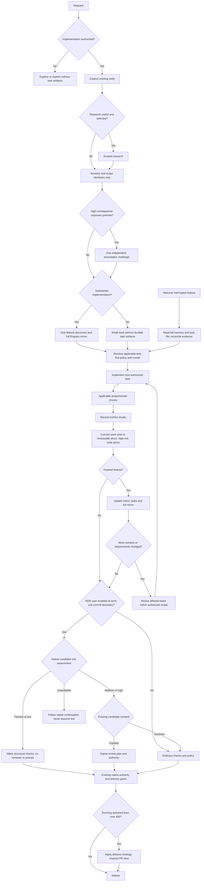

# Agent workflow

Read this entry before acting. ODD is the governing workflow: read-only and small work create no durable feature artifact. For authorized non-small state-changing work, creating the governing feature document from its template is the sole authorized bootstrap write; no other mutation precedes it. Revise an existing document before affected work resumes and apply decision-only stops. This entry routes work; it does not grant authority, replace an owner procedure, or prove delivery.

### Canonical ODD flow

The supplied diagram is preserved with its operational interpretation below. Vendor labels describe capabilities, not installed commands. Written alignment, observed scenario execution and unverified runtime behavior are separate evidence states: the diagram or a green validator establishes no adoption by itself.

- **A–D, J/L:** protocol steps 1–4 determine authority, exploration and substantial versus small work, not file/line counts. Read-only explanation ends with outcome verification, without implementation, commit or tracker requirements.
- **E/F/G:** research is optional when useful and selected, not a compulsory detour; follow the research owner's saved-evidence procedure. Resolve accessible facts first, then only genuine user-only scope decisions through the coordinator. Continue automatically when authorized scope and prerequisites are settled.
- **H/I:** for a high-consequence unproven premise that could materially change the solution, obtain at most one independent evidence-based challenge for that premise before committing to it. Identify the premise, consequence, supporting/refuting evidence and recommendation; the coordinator resolves the result or routes a genuine user decision. Do not manufacture objections, repeat challenge ceremonies for an unchanged premise, or substitute this challenge for existing mandatory reviews.
- **K/T/W/X:** “Engram” maps to the backend-neutral full-mirror contract below, not an installation requirement. The repository document remains authoritative. Create/update it and reconcile its full mirror at tracked work-unit boundaries and resume; unavailable storage has explicit pending recovery, not cache-only substitution or invented success.
- **TT/M/N/Q:** resolve applicable test-first policy and the actual runner before implementation; use protocol step 6 and Behavioral verification and runner selection below. Record observed results honestly, including failed, skipped and pending controls, under the skill's evidence procedure.
- **QC/R/U/V:** commit coherent reviewable authorized work units through the release owner; isolate high-risk units in their own reviewable commits. Update tracked intent/tasks/evidence and mirror, then continue remaining authorized work; changed requirements reopen only affected work under scope readiness. Small work gains no feature document merely to report a commit.
- **O/AB/Y:** native RDD is disabled and unclaimed. At work-unit commit boundaries take ordinary checks and policy; existing architecture, independent acceptance, PR and delivery gates remain binding and are not renamed native RDD. No native assessment, consent ceremony or invented native command is required on this route.
- **P/AC/AD/AE/AF:** these are inactive integration states, not local execution authority. Enablement requires explicit user selection, verified available integration/commands, resolved native semantics and applicable security/dependency approval. A future native passive/low result concerns only its own silent structural checks; medium/high uses actual existing candidate consent, granted review-plan authority or declined ordinary policy. An unavailable assessment is never low risk: use evidenced native continuation or report the integration gap; no AE→delivery edge is supplied or inferred. Native authority never replaces other mandatory gates.
- **AG/AH/S:** use the skill's Delivery forecast procedure: forecast OR running authored additions plus deletions over about 400 triggers the selected strategy before the next commit, not merely at final delivery. The diagram's chained slice is subject to the chosen strategy and existing release authorization; task-size advice is not a hard cap or classification rule. Closing a document is not delivery; apply the skill's Delivery boundary and `knowledge/release.md`.

### Full feature mirror and resume

The feature document is the single authoritative intent/task/status record. Its full mirror is a recovery copy, not a second tracker, summary, readiness register or per-request context injector. This contract authorizes only feature-specific mirror storage within an already-authorized tracked workflow and effective role/tool permissions; an explicit project/task restriction on backend writes still controls. It authorizes no installation, unrelated-memory mutation or destination operation.

1. **Identify and serialize.** Verify the destination-owned project identity and stable feature identity plus repository-relative document locator; do not infer project scope from a similarly named search result. Preserve feature identity across an authorized rename and update its locator. Assign one writer for document/mirror reconciliation under shared coordination; record backend ID and verified identity in the existing Log, not another tracker. Backend/API bindings belong to project configuration/extensions.
2. **Create a full copy.** After authorized template bootstrap, store the entire current document, including header, Specs, Tasks and Log, with project/feature identity, locator and content revision/identity. A locator or summary alone is not a mirror. Keep synchronization pending until full verification succeeds; bootstrap does not override backend-write restrictions.
3. **Validate before updating.** Independently read the existing record; verify actual ID, project, feature and locator against the intended document and previously verified revision before editing. Bounded discovery may locate candidates but cannot establish exact identity or absence when incomplete. Ambiguous/multiple/wrong-scope records require reconciliation, not blind overwrite, duplicate creation or invented exact-key upsert.
4. **Compare all inputs.** Compare the full repository file, full backend copy, last verified revision and current authorized user intent/evidence. A newer timestamp proves no authority. Preserve divergent full versions and identities before replacing either, using an authorized destination-owned durable artifact location or existing versioned evidence; if preservation needs unassigned writes, halt affected replacement and report the boundary. Never let a stale mirror override current intent or discard newer evidenced requirements silently.
5. **Write and independently read back.** Write the reconciled complete document plus locator/identity, separately retrieve the full record and compare its entire payload and identity with the exact current file. Record the actual comparison method, limitations, backend ID, content identity and result in the existing Log; refresh and read back the mirror after that evidence update. A readback of a named file revision establishes only that revision: report verification of the final refresh in the handoff rather than endlessly modifying the payload to describe its own verification. Never claim a subsequent Log mutation was already verified.
6. **Pending recovery.** An unavailable, missing, truncated, mismatched or ambiguous read/write is not synchronized. Preserve the authoritative file and available divergent versions; record the failed operation, verified identities, missing evidence and next bounded recovery action in its Log. Resume unrelated authorized repository work when safe, while affected synchronization stays pending; do not claim complete adoption or substitute cached snippets for full recovery. Retry only within error/budget rules and authority; assume no compare-and-swap or atomicity.
7. **Resume and finish.** Read the full file and full mirror when available after interruption; reconcile current intent and evidence before affected implementation, then re-resolve runner/test policy at TT. With an unavailable backend, reconstruct from repository evidence and report pending recovery; unresolved intent conflicts block affected work, not unrelated work. Refresh the full mirror after material intent/task/evidence changes, work-unit commits and closure. Separate source-policy checks, observed backend round trips and unverified persistence/size/concurrency properties; missing evidence never becomes successful adoption.

### Behavioral verification and runner selection

- Before each implementation task, map each affected `S#` to its observable acceptance action/result and responsible executor/verifier. Carry the actual applicable runner, exact inputs and expected outcome in the handoff; inspect existing test policy/commands rather than inventing a harness. Existing owner execution restrictions and independent semantic acceptance still apply.
- For each requested behavioral rule with a relevant runnable deterministic test, observe at least one RED for that rule's intended reason before implementation, then GREEN and refactor; a failure for another rule is not its RED evidence. Distinguish a reproduced defect from missing environment/dependencies or unrelated failure; record actual exceptions and proportionate static/manual checks when executable RED/GREEN is inapplicable.
- For changed command behavior, run the same changed input against previous and current code in equivalent authorized isolated conditions; compare stdout, stderr and exit status, recording the expected and observed differences. Add regression coverage for every touched existing command or option sharing the changed code, including relevant error cases, not only the newly requested path. Reuse existing shared-state helpers and preserve their invariants rather than introducing parallel state setup; update help and documentation for changed commands, options and messages. These requirements use the actual applicable runner and existing test/implementation owners, not a new harness or execution grant.
- Use isolated disposable inputs and state for mutating examples only when those mutations are explicitly authorized; do not run a destructive/live example merely to obtain RED or a previous/current comparison. Missing authority or an unsafe environment is a reported verification limitation, not permission to skip silently or invent success.
- Verify each affected spec's observable outcome separately from structural health, tests and architecture checks; record literal command/manual-action provenance and observed results under the skill's Implement and verify procedure. An unavailable runner/verifier leaves its check pending or justified N/A, not passed. Prose-only changes use normal/adverse walkthroughs without claiming runtime execution.
- For tracked-feature verification handoff, an independent verifier reads the whole feature document, including its Log, checks the authorized examples against the actual delivered behavior and returns a verdict for each applicable `S#`, citing expected/observed outcomes and missing evidence. Executable examples remain with their authorized execution owners and require a safe authorized environment; independence does not grant runner, state-mutation or installation authority. This handoff supplements, never replaces, the skill's independent whole-feature semantic acceptance.

### ODD protocol

1. **Authorize** — Does the request authorize a change? Read-only requests stay read-only. Findings do not silently expand authorization. Report the permitted outcome and boundary with the request/standing-instruction evidence; COMPLETE when that boundary is established, then explore. Missing user-only authority blocks the affected operation and names the required decision.
2. **Explore** — Read the governing source and its required dependents, proportionately. Load applicable instructions and relevant dependencies. Report inspected inputs and evidence gaps; COMPLETE when sufficient context supports the next decision, then resolve uncertainty. Route resolvable gaps through the coordinator, not automatically to the user.
3. **Resolve uncertainty** — Before implementation, resolve task-relevant uncertainty, identify the requested observable outcome and the minimal sufficient change, and distinguish that outcome from the proposed mechanism. Ask one focused question for a real user-only decision; investigate accessible facts first. Delegated workers report gaps to Cipher 🔓 (Lead Orchestrator) and never invoke the user-facing question tool. Report the resolution and evidence; when no question is needed, state why the available evidence settles the relevant uncertainty. COMPLETE then classify; unresolved prerequisites keep affected work BLOCKED with its resolution owner and next action.
4. **Classify** — Work is small only when it is understood, risk-contained, and resumable from the request plus diff; all three conditions must hold. Non-small work is anything else. Counts of files, commands, tests, fixes, tasks, or requested todo lists never decide classification. This ODD test is the authority for new work. Report the evidence for all three tests and resulting class; COMPLETE then apply step 5, including its artifact-free route. Missing classification means stop and report before writing. Do not start step 5, and do not mutate, until the three-test result is reported.
5. **Track before the first write** — Read-only and small work create no durable feature artifact: report artifact creation NOT APPLICABLE with that reason, then proceed only within the authorized route. For authorized non-small state-changing work, creating the governing feature document from `odd/tasks/_template.md` is the sole authorized bootstrap write. A missing required feature document permits only that authorized bootstrap creation. No other mutation — edit, write, delete, rename, or mutating shell command — precedes it. Never implement first and document retroactively. Revise an existing governing document before affected work resumes. Produce the feature document and execution review under `AGENTS.md` → Conventions → Decision-only stops; report its evidence, gates and any pending decision. Apply Full feature mirror and resume after bootstrap, reporting unavailable or prohibited storage as pending rather than verified. Continue already-authorized settled work without an automatic creation/replan pause; unresolved authority or prerequisites block affected implementation. Authorization and applicable safety/review gates remain independent.
6. **Implement task by task** — Deliver coherent slices in dependency order, respecting owner gates; dispatch independent ready tasks concurrently under the shared coordination rules. Define applicable acceptance checks and collect actual verification evidence with each task, not only at PR preparation. Tests and documentation ship with the slice. Follow the odd-workflow skill's implementation evidence procedure. When a relevant runnable deterministic test and a clear expected outcome exist, observe RED before implementation, then GREEN and refactor; otherwise record the actual exception and run proportionate checks. Never invent a runner or a test where none applies; do not add a test harness. Existing architecture/edit gates, whole-suite ownership, and independent completion review remain binding. Report each slice's result, outcome evidence, check/gate states and next ready task; when an existing feature's `## Tasks` row is marked `done`, report that transition at the time with the task outcome, commit, supporting evidence, applicable checks/gates and their state, and next ready task. The feature document remains the sole task/status record. Loop here while tasks or applicable owner gates remain. An authored slice may finish while step 6 remains IN PROGRESS: never mark it COMPLETE pending an applicable owner gate. When all task delivery gates and outcome checks are satisfied, report COMPLETE and advance to independent feature acceptance in step 7. Read-only work reports implementation NOT APPLICABLE and advances to outcome verification without mutation.
7. **Close** — Before claiming any task done, verify the requested observable outcome separately from tests, architecture review or source-health checks; those checks do not substitute for outcome evidence. Apply the odd-workflow skill's independent semantic completion review before a feature completion claim; anatomy validation or a green suite alone is insufficient. Report the verified outcome, missing evidence, every failed or pending check/control, and the next step; do not represent pending controls as satisfied. Reproduce a reported failure before deciding it already works. Feature acceptance is independent of step 6 slice/owner-gate acceptance; follow the skill's Close safeguards. COMPLETE only with current required acceptance and outcome evidence; otherwise remain IN PROGRESS/BLOCKED or return to the affected earlier step. Small/read-only work verifies its outcome without creating a feature artifact. Exhausted verified authorized scope ends with ALL FINISHED; remaining authorized work continues under the transitions below.

These uncertainty and outcome controls apply to every task, including small and read-only work. Apply `### Scope changes and readiness` when scope, inputs or prerequisites change. The visible checkpoints below add no permission, approval gate, or user confirmation; they do not create another tracker or count threshold, and existing approvals remain binding within their scope.

#### Step reporting and transitions

- **Step report:** after each completed step, report feature/task identity; step number and name; state; result; evidence pointer; next action.
- **Compact combined report:** contiguous preparatory or read-only steps may be reported once, carrying each step's number, name, state, result, evidence pointer and next action. Never combine across an authorization pause, an edit checkpoint, or an independent acceptance gate, and never omit a pending check or blocker.
- **States:** ✅ COMPLETE · 🟡 IN PROGRESS · 🚧 BLOCKED · ⏭️ NOT APPLICABLE/SKIPPED. The full vocabulary and presentation rules live in `knowledge/agents.md` `### Message presentation`.
- **Continuation:** continue to the next ready task inside the active authorized scope; task completion is not a stop. A blocker is an unmet prerequisite preventing the affected operation: name its resolution owner and next action. Resolve coordinator/agent-resolvable blockers within existing authority; only a genuine user-only decision or permission requires a user stop with the exact user action. If the authorized scope is exhausted and verified, say `ALL FINISHED` with delivered scope, verification, deferred items, and next options; do not select unrelated work.
- **Skipped steps:** a skipped or inapplicable step states its reason. A checkpoint or owner-gate return (`AWAITING_REVIEW`, `BLOCKED`) is not step completion.
- **Transitions:** the seven steps are not seven implementation tasks; step 6 repeats task-level delivery. A failed review stays in step 6 unless it exposes a requirement or scope change, which returns to the affected earlier step. Step 7 is incomplete while any required review or check remains.
- **Visible phase/prerequisite checkpoint:** Before beginning a phase transition or mutation unit, report the current ODD step and state, the next phase or planned unit and its authorized scope, and the evidence that its prerequisites are satisfied; identify any unmet prerequisite, its resolution owner, and next action. After a user correction or changed prerequisite, apply `### Scope changes and readiness`, then report the revised phase/scope and current prerequisite evidence before resuming. Checkpoints are required at mutation-unit and phase-transition boundaries, not before each edit within an already-authorized slice. Follow the user-facing message contract in `knowledge/agents.md` → `### Message presentation`; these reports make protocol compliance visible and auditable but do not technically prevent an agent from skipping them.
- **Static permission boundary:** Configured tool permissions (including V2 path limits or protected-file rules where applicable) constrain available operations; they do not establish ODD phase completion or prerequisite satisfaction and do not enforce these reporting checkpoints. This protocol adds no permission or configuration change.
- **Bootstrap and decision boundary:** creating the governing feature document is the sole bootstrap write. Execution review and decision-only stops after creation or material replanning are owned by `AGENTS.md` → Conventions; this protocol points to that owner rather than adding an automatic pause.

**Illustrative examples only — not execution evidence or actual feature status.**

- **Uncertainty resolved without a question:** `example-feature · T1 — Step 3 Resolve uncertainty — ✅ COMPLETE — uncertainty: whether small work requires a feature document. Evidence: knowledge/agent-workflow.md, ODD protocol steps 4–5, explicitly makes small work artifact-free. Requested outcome: follow the authorized small-work route; minimal sufficient change: no feature-document creation. No additional research or user question required: the existing contract settles the artifact requirement; classification remains to be established. Next: Step 4 Classify against all three tests. Continuing.`
- **Authored slice, owner gate pending:** `example-feature · T4 — Step 6 Implement task by task — 🟡 IN PROGRESS — authored presentation slice finished; applicable owner review pending. Evidence: candidate slice and pending gate recorded in the example feature Log. Next: obtain owner verdict before completing step 6; step 7 independent feature acceptance follows delivery gates. No user action needed: the coordinator can dispatch the authorized review. Continuing.`
- **Skipped check, not a completed phase:** `example-feature · T5 — Step 6 Implement task by task — 🟡 IN PROGRESS; RED/GREEN check ⏭️ NOT APPLICABLE — reason: prose-only slice has no applicable executable test; manual walkthrough is recorded in the example feature Log. Next: finish pending owner review, then independent feature acceptance. Continuing.`

### Scope changes and readiness

Cipher 🔓 (Lead Orchestrator) owns reassessment; workers stop affected operations and report gaps or stale evidence to the coordinator. On a correction, scope expansion or changed prerequisite:

1. **Stop affected work.** Invalidate affected readiness, assignments and evidence before further implementation; do not discard unrelated work or treat every correction as material replanning.
2. **Identify the delta.** Re-evaluate the requested observable goal against the proposed mechanism and scope. State what changed and justify each retained conclusion against current evidence; an earlier `COMPLETE` declaration alone is not content-specific evidence of exploration, resolved uncertainty or readiness for the changed scope.
3. **Re-explore affected context.** Read the affected authoritative sources and required dependencies, reassess relevant risks, and resolve affected uncertainty under protocol steps 2–3. Reclassify under step 4 if the delta affects understanding, risk containment or resumability. Preserve unaffected conclusions where their inputs and applicability remain valid; mandatory full/fresh-read obligations still apply.
4. **Revise the affected plan.** Update affected Specs, tasks, acceptance checks and assignments before affected work resumes, using the `odd-workflow` skill for feature-record operations. Small/read-only work keeps corrected intent in the existing conversation/diff, without a feature artifact; a changed classification follows step 5's existing route.
5. **Apply decision-only stops.** Initial feature creation and material replanning use `AGENTS.md` → Conventions: present Issue → Goal → How → Files, current gates and any genuine decision needed; stop affected implementation only for unresolved authority or prerequisites. Routine Log/evidence-only updates do not restart review. Already-authorized settled work continues; this section creates no universal independent gate or approval requirement.
6. **Resume on current prerequisites only.** Check that the accepted inputs, conclusions, checks, owner gates and approval still cover the affected scope; obtain any required refreshed acceptance or approval before resuming. Report content-specific evidence and missing/stale prerequisites with their resolution owner and next action. Prior approval does not authorize an added scope merely because earlier steps were marked complete.

On resumption, authoritative repository owners and the governing feature record establish current scope and state. Follow `AGENTS.md` → Memory system for bounded recall and verification, and Full feature mirror and resume above for complete tracked-feature reconciliation. Ordinary cache assistance is not an authoritative prerequisite; a stale or missing cache is neither readiness evidence nor a reason to block repository-based resumption. Preserve mirror conflicts and report unavailable recovery explicitly rather than claiming synchronization. Verify recalled leads against authoritative files; create no competing readiness tracker or per-request context-injection mechanism.

### Release workflow

Apply `knowledge/release.md`. That file owns PR release readiness and post-review finding actions. This entry does not restate them.

### Task-specific navigation

Use the ODD classification and authorization rules above before choosing a change route. Start with the assignment's exact source paths, relevant dependencies, applicable runtime and skill; explore further only where the task or an unresolved fact requires it. Content already current in the run — injected instructions, a file read in this session, an accepted agent return, an existing artifact — satisfies an ordinary reading requirement for that content; re-read it only when it changed, when the available evidence is incomplete, or when its owner requires a fresh read. Search the named path first and expand only for an identified dependency or evidence gap. Mandatory full-guide, full-file and fresh-read obligations are unaffected and remain binding. This is the workflow router, not another task tracker.

| Task | Applicable read-pointers and boundary |
|---|---|
| Read-only explanation or inspection | Read the governing source and relevant dependencies. No feature artifact; unrelated read-only questions do not trigger blanket architecture reading. Architecture-dependent explanations follow the shared clean-architecture applicability rule. |
| Authorized non-small change | Read the governing `odd/tasks/<YYYY-MM-DD>-<feature-name>.md` through `## Log`, the assigned `S#` and relevant Log evidence, then the named source/dependency paths and owner procedure. Only authorized template-based creation of that document may bootstrap; no other mutation precedes it, and revisions precede affected work. Small work remains artifact-free. |
| Implementation or architecture/conformance review | Follow `knowledge/agents.md` → Clean architecture → `architecture/README.md` for common contract, applicable shapes and selected implementation guide. Preserve the owner's required full reads, relevant context, warmups and fresh-read checkpoints. |
| Testing design, test edit or test review | Follow `architecture/testing/architecture.md` and its applicable stack guide, with `.opencode/agents/crucible.md` and any additionally applicable language-owner procedure. Execution/install and edit gates remain runtime-owned. |
| Research or saved-evidence reuse | Follow `.opencode/agents/augur.md` → Research Workflow and the project's configured catalog, matching topics, cited evidence, template and publication owner. Inspect applicability/freshness before reuse and investigate bounded gaps; unrelated tasks do not require a research detour. |
| Incident identification | Follow `knowledge/agents.md` → Register-first identification and the assigned incident runtime/skill: symptom → incident problem → verdict, before evidence-only archive/pattern/KBA lookup after `no_match`. |
| Historical context | History, research and persona material do not replace current rules or become general prerequisites; retain any owner-required persona reads. |
| Cache retrieval or code analysis | Apply `knowledge/agents.md` → Applicable analysis tools and the root runtime's project bindings: use relevant exposed, authorized tools during exploration/review, report justified non-use or limitations, and retain role scope, full reads and execution gates. |

Crosslinks locate owners; they do not require recursive rereading of every linked document. This does not waive runtime-required fresh/full reads or relevant dependency exploration. If a required pointer is missing, stop the affected operation and report the exact configured path, expected owner and missing evidence to Cipher 🔓 (Lead Orchestrator); never guess a replacement. An optional unconfigured/unavailable research catalog follows the research runtime's explicit gap-reporting route instead.

### Feature document

One feature owns one authoritative record in `odd/tasks/`, not a second tracker or per-request context-injection mechanism. Its subordinate full mirror follows Full feature mirror and resume above; it never becomes independent intent or status authority. Its Log holds decisions and evidence, not a running execution transcript.

Before creating or maintaining a feature record, load and read the `odd-workflow` skill (`.opencode/skills/odd-workflow/SKILL.md`) and its applicable references. That skill owns record mechanics: `### Create a feature document` (filename/date exceptions, header, behavior-first verbatim Specs, Tasks and Log), `### Delivery forecast`, `### Change a requirement`, `### Handoff`, `### Feature scope`, implementation evidence and independent closure. Read its checklist in full before creation or closure. Use `odd/tasks/_template.md` as the sole template; concise template/checklist manifestations do not replace the skill. Universal authorization, classification, scope-current readiness and reporting remain in this workflow; release and runtime owners retain their authority.

### Template rule

Every repeatable artifact has exactly one template. Create a new file by copying its template and filling it; never reconstruct the format by research. If a second instance of a file type is needed and no template exists, create the template first.

| Artifact | Template |
|---|---|
| Feature document | `odd/tasks/_template.md` |
| Feature-document checklist | `.opencode/skills/odd-workflow/references/_checklist.md` |
| Implementation stack guide | `architecture/implementation/stacks/_template.md` |
| Testing stack guide | `architecture/testing/stacks/_template.md` |

### Conflict

Identify both obligations, their authority, owner, impact, and disposition. Stop affected action while unresolved. Do not silently expand unrelated work. Do not defer mandatory safeguards or necessary touched-file rework because correction is complex. Route unrelated defects to their owner with explicit deferral; reporting is not accepted debt.

### Keep files small

Put each concern in its owner. Before growing a file, remove duplication or extract a named responsibility with purpose, applicability, owner, and an explicit read-pointer. Do not split by arbitrary parts.

A distinct workflow (for example release) belongs in `knowledge/<flow>.md`, not in this ODD protocol file and not in an agent runtime. Move the obligation, replace the old body with a pointer, and inject the new home through `instructions` only when it replaces law that was already injected — never as a second copy. Project grants for that flow live in that file's `project` region or in `AGENTS.md` project extensions, not in this core protocol.

Extract skill support to `.opencode/skills/<skill>/references/<concern>.md`; executable tooling to `scripts/`; a new common policy to `knowledge/<concern>.md`. Architecture definitions belong in `architecture/`: select through `architecture/README.md`, read `architecture/implementation/architecture.md`, applicable `architecture/implementation/shapes/`, and the selected implementation guide in `architecture/implementation/stacks/`; testing definitions belong in `architecture/testing/architecture.md` and its selected stack guide. Agent runtimes retain authority, execution, scope, gates, dependency ownership, and reporting, not competing definition copies. Source-local ADRs explain decisions at the project's configured record location and are not required shared dependencies; their lifecycle and propagation gate are owned by `knowledge/architecture-decision-workflow.md`. Move each obligation to one home, replace the old body with a pointer, update consumers, and verify links and clearance before deleting the old copy. Shared required extracts ship with clearance; source-local history is not a shared dependency.

New architecture paths and their consumers ship together through applicable clearance, including directory-root clearance where configured; destination-authorized `core-sync init --bind-cleared` enrollment is required for new or markerless paths, not `apply` alone. Destination reconciliation remains destination-owned; pending reconciliation blocks acceptance. Documentation review does not establish implementation conformance or authorize application remediation.

Durable history lives at its owner: the feature document's `## Log`, the ADR, and `docs/architecture/history/`.
