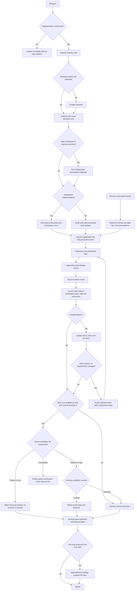

# ODD workflow fidelity and instruction organization

> **Status:** active
> **Owner:** Cipher 🔓 (Lead Orchestrator)
> **Created:** 2026-11-03
> **Objective:** Prepare the coordinated ODD adoption plan and its first implementation-ready workflow slice using available or separately approved tools; implementation remains execution-review gated.
> **Branch:** docs/odd/align-workflow-fidelity
> **Delivery:** ask-on-risk, stacked-to-main; first work unit forecast 372 authored additions plus deletions, Git-measured 306 authored changed lines, below the strategy trigger. Later slices forecast at their own start. No publication authorized.
> **Runner:** `uv run --frozen python3 .opencode/skills/odd-workflow/scripts/validate_feature.py odd/tasks/2026-11-03-odd-workflow-fidelity.md`

Load and read the `odd-workflow` skill (`.opencode/skills/odd-workflow/SKILL.md`) before creating or maintaining this record. Its creation, delivery, change and closure procedures are canonical; this template illustrates their layout, not another policy definition.

## Specs

- S1 — The proposal accounts for every transition in the supplied ODD diagram together with its accompanying upstream prose. Exact requirement: "please this diagram is very important  is it defined on our project?" Acceptance: inspect the proposed mapping; each node and edge has a local owner, available capability or explicit unresolved gap, and normal/adverse verification scenario. The supplied diagram is preserved in L5.
- S2 — Tool equivalence targets strict behavioral fidelity without pretending unavailable Gentle AI commands exist. Exact requirement: "i want strict fidelity but i already know we cant follow it exactlu i said it for those tools that just are available on the real Gentle ai project it ahve its own tools that enforce it but i want u to try is strictly with the tools we have, u can propose to install new tools if needed". Acceptance: inspect each capability recommendation; available-tool evidence, limitations and approval requirements are explicit; native RDD is neither claimed nor enabled without evidence and authority.
- S3 — The proposal evaluates root organization and duplicated obligations without unapproved obligation loss. Exact requirement: "the  current agents.md file content need a review i think its not well organiized and i am worried about what is contains." Acceptance: compare identified originals with proposed owners; every valid obligation is retained, translated or proposed for explicit retirement with rationale, and approval-language conflicts are dispositioned.
- S4 — The proposal evaluates retiring separate profiles after migrating useful specialist behavior to each owning runtime and distinguishing globally shared behavior from coordinator identity and authority. Exact requirement: "if i am understanding well the actual profile files are more a problem than a benefit if u recommend we can dispose of them and move it to then own agent, and about cipher move that to root agents as a globall followup for all the agents". Acceptance: inspect the persona proposal; preserved behavior, retired duplication, exact consumers and distribution consequences are listed before deletion is authorized.
- S5 — Proposed shared behavior requires independent evidence-based judgment rather than pleasing agreement or automatic contrarianism. Exact requirement: "1 thing more i think in your behjavior should be added to be critical and not compliant always". Acceptance: walk through an unsupported premise and an already-supported authorized choice; the candidate challenges the former with evidence and proceeds with the latter without invented objections.
- S6 — Adoption reporting distinguishes written alignment, observed execution and unverified behavior. Exact requirement: "we have a file were we were tracking the adoption progress but seems like it is lying". Acceptance: inspect the proposed status treatment; documentary checks and observed scenario evidence are separate and no green validator is represented as autonomous compliance.
- S7 — The reusable bootstrap and synchronization tool remain complementary project responsibilities. Exact requirement: "this project is the owner of the tool and this project will be used in many other to ahve a strong base bootstrap." Acceptance: inspect the plan; reusable contracts remain neutral and destination-owned reconciliation is not performed here.
- S8 — Planning decisions use the question tool with explicit recommendations after accessible facts are investigated. Exact requirement: "PLEASE USE THE QUESTIONS TOOLS TO MAKE CHOICES AND DONT FORGET YOUR RECOMMENDATIONS. WHY U STOP ?" Acceptance: inspect the execution-review handoff; it supplies Issue → Goal → How → Files and a focused recommended choice, not an unsupported policy default.
- S9 — Authorization is recorded as an append-only chain, and the current bound is the most recent approved decision rather than a fixed list. Approved option wording: "Coordinated plan (Recommended)"; initial authorization context: "This authorizes preparing the governing feature document—not implementation, installation, or destination changes." Each later bounded approval is recorded verbatim at its own Log entry, including the disposable probe, the first source-contract slice, mirror activation, the record-design revision and the evidence-retention policy. Acceptance: inspect the Log approval entries and the changed paths; work stays inside the most recently approved scope, and nothing absent from that scope (installation, persona deletion, publication, destination change) is treated as authorized.
- S14 — Disposable evidence is referenced only from inside `odd/`. Exact approved requirement: "something important if it will be disposable, nothing outside ODD folder should point to those files". Acceptance: search durable surfaces outside `odd/` for specific evidence-instance paths; no hit exists. A durable owner may name the `odd/evidence/<feature>.md` convention as a rule, but no `AGENTS.md`, `knowledge/`, `docs/` or skill text cites an individual evidence file, so disposal cannot leave a dangling reference.
- S15 — Specialist persona behaviour lives in each role's owning runtime, with shared conduct in the root, and separate profile files are retired only after their useful behaviour is preserved. Exact approved wording: "Consolidate, scoped roles (Recommended)". Acceptance: an independently reviewed preservation plan accounts for every profile clause as retained, translated or retired; after implementation no runtime, skill, audit rule, clearance entry or source-contract test references a deleted profile; the root keeps shared conduct while coordinator identity and authority stay scoped; and distribution consequences for destinations are stated explicitly rather than assumed.
- S16 — Destination impact of retiring a delivered tier is documented at its durable owner, not left implicit. Exact approved wording: "Retire + migration note (Recommended)". Acceptance: the core-sync skill states that a destination bound to the retired `agents/` root must preserve any project-region persona text it authored before removing its own profile files and stale binding entries, and that reconciliation remains destination-owned; removing the cleared root is recorded as a compatible registry change under `distribution-clearance.definition.md`, not as a schema bump.
- S10 — The proposed first slice makes the supplied flow operational in one canonical workflow owner while retaining the selected capability boundaries. Exact approved scope wording: "canonical diagram plus complete ODD flow rules, selected mirror/resume contract, decision-only stops and shared critical conduct." Acceptance: inspect the proposed workflow rules and scenario matrix; every L5 node/edge has an explicit disposition, optional native RDD remains disabled/unclaimed, and unavailable native continuation does not become invented delivery authority.
- S11 — This feature record gains a real full mirror with verified identity and reconciliation evidence, exercising detection of a divergent revision. Exact approved wording: "Authorize bounded real mirror create/readback/reconcile for this feature, run the resume/conflict scenarios". Prerequisite: the record must reach its final compacted revision under S13/S14 and a transfer-and-readback route must be verified under T14 before any mirror is created, because an intermediate revision would be pinned and then immediately invalidated. Acceptance: create the mirror for the final record revision in the selected project, read it back independently and compare it against that exact file revision; after the record legitimately advances, confirm the stored copy is identifiable as an older revision, reconcile, read back again, and record backend ID, verified revisions and comparison method. If write is model-mediated and readback cannot be compared completely, record pending recovery instead of claiming synchronization. Limit: persistence across restart, concurrent writers and maximum document size remain unverified and must be reported as such.
- S12 — The adoption-status document stops asserting alignment that this and earlier slices contradicted. Exact approved wording: "then correct adoption-status claims to observed evidence". Acceptance: read the whole document; every corrected row cites the current owner file content and the recorded slice evidence, observed execution and unverified behaviour are separated, retired deviations (no-mirror, automatic pause) are removed or re-labelled, historical snapshot boundaries are preserved, and no row claims runtime compliance from documentary checks.
- S13 — Keep one authoritative feature record with concise decision/change/outcome entries, linking durable detailed evidence without creating another task tracker. Exact approved proposal: "compact record + linked durable evidence + behavior-based feature boundaries + verified deterministic mirror transfer." User approval: "i aggred". Acceptance: compare the original record and proposed extraction; original requests, corrections, decisions, obligations, delivery commits and verification provenance remain available, while duplicate procedural narration is removed or linked. Do not impose an arbitrary line ceiling or alter verbatim requirements. Verify the transfer interface before authorizing helper implementation or installation.

## Tasks

- T1 | S1, S2, S7 | delegated (saved-research reuse and current primary-source/tool capability assessment require the research owner) — Augur 🔮 (Research Analyst): identify an immutable upstream baseline; map diagram/prose requirements, memory/resume, RDD, tests and delivery to real local capabilities; return bounded evidence and installation options | open | commit: pending
- T2 | S3, S4, S5 | delegated (roster/persona changes require the roster owner; dependent on accepted T1 scope) — Marshal 🎖️ (HR Director): inventory exact runtime/profile/authoring consumers and propose behavior ownership; no edits or deletion | open | commit: pending
- T3 | S1, S2, S3, S6, S7, S8, S9 | inline (coordinator owns synthesis, decisions and the governing feature record) — Cipher 🔓 (Lead Orchestrator): join accepted evidence into exact phased changes, file lists, retained/translated/retired obligations, capability decisions and acceptance scenarios; present execution review before implementation | open | commit: pending
- T4 | S1, S3, S4, S5, S6, S9 | delegated (independent challenge of the plan and preservation accounting) — Sentinel 🛡️ (Quality Guardian): review in-scope instruction/feature proposals; report limits for research/configuration outside role scope | open | commit: pending
- T5 | S1, S2, S3, S4, S5, S6, S7, S8, S9 | inline (coordinator-owned structural validation and separate outcome acceptance) — Cipher 🔓 (Lead Orchestrator): validate the record, verify proposal coverage and current gates, and obtain scoped user decisions without claiming implementation delivery | open | commit: pending
- T6 | S1, S2, S3, S5, S9, S10 | delegated (approved first workflow slice; identified original inputs and accepted owner gate) — Scribe ✍️ (Docs & Problems Manager): author the exact L31 workflow/runtime/shared-rule changes and return an edit checkpoint before continuation | done | commit: 4fe3bb316b32929101ecb5ee97fc262aa39ac789
- T7 | S1, S2, S3, S9, S10 | delegated (ODD skill consumer alignment, proposed only; depends on accepted T6 owner review) — Scribe ✍️ (Docs & Problems Manager): align ODD skill/checklist to the accepted workflow owner, retaining unique record mechanics and original-obligation accounting | done | commit: 4fe3bb316b32929101ecb5ee97fc262aa39ac789
- T8 | S1, S2, S3, S5, S9, S10 | delegated (independent combined-candidate acceptance; proposed only) — Sentinel 🛡️ (Quality Guardian): audit applicable root/shared/workflow/record surfaces; Vault 🔐 (Catalog Steward) separately reviews skill scope; join does not substitute for either owner's gate | done | commit: 4fe3bb316b32929101ecb5ee97fc262aa39ac789
- T9 | S1, S2, S3, S5, S9, S10 | inline (coordinator outcome checks and evidence join, proposed only) — Cipher 🔓 (Lead Orchestrator): run scoped validators/manual walkthroughs, retain explicit runtime gaps and obtain release-owner commit evidence before any done transition | done | commit: 4fe3bb316b32929101ecb5ee97fc262aa39ac789
- T10 | S11 | inline (single mirror writer; serialized backend identity and readback verification cannot be delegated without splitting writer ownership) — Cipher 🔓 (Lead Orchestrator): create, verify, re-verify and reconcile this feature's full mirror | open | commit: pending
- T11 | S11, S12 | delegated (documentation remediation authored by the docs owner; independent of mirror writer after evidence is recorded) — Scribe ✍️ (Docs & Problems Manager): correct `docs/architecture/odd-adoption-status.md` against current owners and recorded slice evidence | done | commit: 8071ad94a9b7d092e8ca9b4fe89603e2e90270e9
- T12 | S11, S12 | delegated (independent review of the corrected status document and evidence consistency) — Sentinel 🛡️ (Quality Guardian): audit applicable documentation surfaces and report findings; does not re-execute backend checks | done | commit: 8071ad94a9b7d092e8ca9b4fe89603e2e90270e9
- T13 | S13 | delegated (documentation owner inventories preservation and evidence placement before compaction) — Scribe ✍️ (Docs & Problems Manager): propose exact record/evidence-owner changes, required template and complete preservation mapping; read-only preparation | done | commit: b13fff0ece729ef03952caf40fe79895a1d57370
- T14 | S11, S13 | delegated (research owner verifies exposed transfer interfaces before code is proposed) — Augur 🔮 (Research Analyst): establish a feasible full-content transfer/readback mechanism and its authority boundaries; read-only preparation, no backend mutation or installation | done | commit: b13fff0ece729ef03952caf40fe79895a1d57370
- T15 | S13, S14 | delegated (record design, evidence template and consumer policy wording authored by the docs owner) — Scribe ✍️ (Docs & Problems Manager): create `odd/evidence/_template.md`, extract attestational evidence for this feature, compact this Log, and align ODD skill/checklist/workflow/template wording including the no-external-pointer rule | done | commit: b13fff0ece729ef03952caf40fe79895a1d57370
- T16 | S13, S14 | delegated (independent review of retention policy, compaction and reference boundaries) — Sentinel 🛡️ (Quality Guardian): audit the compacted record, evidence template, skill/checklist wording and the no-outside-pointer rule; Vault 🔐 (Catalog Steward) reviews the skill change | done | commit: b13fff0ece729ef03952caf40fe79895a1d57370
- T17 | S13, S14 | inline (coordinator verifies preservation, retention boundaries and structural checks) — Cipher 🔓 (Lead Orchestrator): run validators, verify no outside evidence pointers, confirm every preserved obligation is reachable, and obtain release-owner commit evidence | done | commit: b13fff0ece729ef03952caf40fe79895a1d57370
- T18 | S4, S15 | delegated (roster and persona ownership; read-only plan before any authoring or deletion) — Marshal 🎖️ (HR Director): produce the exact preservation and dependency plan for consolidating persona behaviour into owning runtimes and retiring separate profile files, including every consumer, audit rule, clearance entry and source-contract test that assumes today's split | done | commit: 998de0b
- T19 | S15 | delegated (roster owner authors persona-bearing runtime cores; the whole tier must land as one atomic unit) — Marshal 🎖️ (HR Director): add the frozen manner clauses to the root and 16 runtimes, remove profile pointers, delete the 17 profile files, and update its own persona contract | done | commit: 998de0b
- T20 | S15, S16 | delegated (documentation and catalog surfaces outside role runtimes) — Scribe ✍️ (Docs & Problems Manager): update the creator skill and rendered example, the core-sync migration note, the clearance definition, README, PROJECT-STRUCTURE and the adoption-status row | done | commit: 998de0b
- T21 | S15 | delegated (test-file authoring with owner gates) — Forge 🔨 (Implementer): invert the profile-count contract with an observed RED then GREEN, and drop the retired `agents/` clearance root from the registry | done | commit: 998de0b
- T22 | S15, S16 | delegated (independent gates over the combined candidate) — Sentinel 🛡️ (Quality Guardian) preservation audit, Vault 🔐 (Catalog Steward) on skill and clearance, Crucible 🔥 (Test Architect) on the changed test file, Bastion 🧱 (Backend & Scripts Architect) on the changed script, then Cipher 🔓 (Lead Orchestrator) join and release-owner commit | done | commit: 998de0b

## Log

- L1 — Original request, verbatim:

> the  current agents.md file content need a review i think its not well organiized and i am worried about what is contains.
>
> and should we add this  G:\projects-personal\ai-core\agents\cipher\profile.md to opencode instructions it fells it is forgetting ho it shoul be its behaviour, and there sems to be duplicated things,
>
>  another thing agents.md have **Cipher owns:** but never mention Orgenic Driven development .
>
> and it seems this is not beinf followed as it is designed
>
> https://github.com/Gentleman-Programming/gentle-ai/blob/main/docs/usage.md#organic-driven-development-odd
>
> we have a file were we were tracking the adoption progress but seems like it is lying

- L2 — 2026-11-03 correction, verbatim: "please be critical and not compliant, explore the scope and make proposals"
- L3 — 2026-11-03 correction, verbatim:

> if i am understanding well the actual profile files are more a problem than a benefit if u recommend we can dispose of them and move it to then own agent, and about cipher move that to root agents as a globall followup for all the agents
>
> about P7 i am not sure if i understood but this project is the owner of the tool and this project will be used in many other to ahve a strong base bootstrap.
>
> i am interest on all your proposals, please make a double check on your analysys and then ask me using the question tool if u need desicions from me and please make me recommendations, be critical and not compliant.
>
> 1 thing more i think in your behjavior should be added to be critical and not compliant always

- L4 — 2026-11-03 correction, verbatim:

> hey i think u missed to analyse this here is all the workflow of organic driven development, there is a nice diagram
>
> https://github.com/Gentleman-Programming/gentle-ai/blob/main/docs/usage.md#organic-driven-development-odd
>
> analyze PLEASE and then start the questions

- L5 — 2026-11-03 clarification, verbatim:

> i want strict fidelity but i already know we cant follow it exactlu i said it for those tools that just are available on the real Gentle ai project it ahve its own tools that enforce it but i want u to try is strictly with the tools we have, u can propose to install new tools if needed, and please this diagram is very important  is it defined on our project?

- L6 — 2026-11-03 correction, verbatim: "PLEASE USE THE QUESTIONS TOOLS TO MAKE CHOICES AND DONT FORGET YOUR RECOMMENDATIONS. WHY U STOP ?"
- L7 — 2026-11-03 authorization: user selected "Coordinated plan (Recommended)" in the question tool. The displayed scope authorized preparing this governing feature document and a coordinated plan, not implementation, installation or destination changes. The earlier "Strict upstream fidelity" choice is qualified by L5; it does not mandate unavailable vendor tooling or authorize installation.
- L8 — Exploration evidence: the current root, shared rules, workflow, ODD skill/checklist/template, profile, distribution clearance, adoption status and OpenCode V2 instruction/agent documentation were inspected, and a repository Markdown search for `flowchart TD` and distinctive supplied labels found no operational copy of the diagram. Bounded search evidence, not proof of execution behavior. Inspection and search detail: E4.
- L9 — Accepted independent challenge: Sentinel 🛡️ (Quality Guardian) read the root, shared rules, workflow, profile and its own runtime without writes, corrected the write-only ODD claim, rejected zero-runtime-effect inference from a profile pointer, confirmed duplication with unique obligations to preserve, and identified the root's "only destructive/irreversible" approval wording conflict. Its verdict was UNCERTAIN about overall prior-analysis reliability, not feature acceptance; prior unsupported causal, token, topic-count, version-bump and percentage claims were withdrawn in chat. Instance, session and read scope: E3.
- L10 — Classification: non-small because workflow, role behavior, distribution consumers and verification semantics interact; risk is not contained to a simple edit and resumability requires a requirement/capability map. Bootstrap authority is L7. Current rules remain operative until separately approved changes; this record does not bypass the current mirror prohibition or execution-review pause.
- L11 — Candidate footprint to investigate, not an implementation write grant: `AGENTS.md`; `knowledge/agent-workflow.md`; `knowledge/agents.md`; `knowledge/release.md`; `.opencode/skills/odd-workflow/`; `odd/tasks/_template.md`; `.opencode/agents/`; `agents/`; persona-authoring consumers including `.opencode/skills/op-agent-creator/`; `opencode.jsonc` only if a concrete loading/tool capability requires it; `distribution-clearance.json`; `distribution-clearance.definition.md`; `README.md`; `PROJECT-STRUCTURE.md`; `docs/architecture/odd-adoption-status.md`. Exact paths, independent owner gates and original/candidate identities must precede any proposed implementation. No CI, dependency change, installation, publication or destination mutation is authorized here.
- L12 — Bootstrap checkpoint: only this record was authored. Next decision is authorization of read-only T1/T2 investigation and subsequent synthesis/review within the planning scope. No implementation task is included; later implementation requires an explicit plan revision and its existing execution-review gate.
- L13 — 2026-11-03 user selected "Proceed with investigation (Recommended)" in the execution-review question: bounded research, persona-consumer inventory, synthesis and independent challenge are authorized; only this record may be updated. Implementation, installation, deletion and destination changes remain unauthorized.
- L14 — T1 research return accepted as planning evidence, not completion or runtime verification: Augur 🔮 (Research Analyst) pinned upstream `main` to `7d3528877d987765e4e5c504ed6049c3da7c4f4c` and compared its usage diagram/prose with current local owners. Limits retained: full mirror is prohibited locally; native RDD is unverified; explicit testing, independent-challenge, delivery and high-risk isolation details remain partial; upstream usage and review-integration documents disagree on size-triggered native review, to be resolved before any native-parity claim; reported node/edge coverage is documentary and the proposed normal/adverse scenarios were not executed; no writes or installations. Identity, method and resource state: E3.
- L15 — 2026-11-03 additional user direction, verbatim: "AND PELASE AGAIN I GIVED U MANY TIMMES THIS USEFULL DOCUMENT READ IT TOO https://raw.githubusercontent.com/Gentleman-Programming/gentle-ai/refs/heads/main/docs/usage.md". Coordinator fetched that exact full page, including detailed prose and diagram. The pinned T1 baseline supplies the reproducible source identity.
- L16 — 2026-11-03 user selected "Full mirror contract (Recommended)": plan replacement of the prohibition with stable project/feature identity, full document plus locator, readback verification, conflict preservation and unavailable-backend recovery. Investigate existing Memories capability first; this authorizes no memory mutation, installation or policy implementation.
- L17 — 2026-11-03 user selected "Disabled, integration-ready (Recommended)": proposed native RDD remains disabled/unclaimed; preserve optional branch, consent/failure states and enablement prerequisites. Existing architecture/PR gates continue and are not relabeled native RDD.
- L18 — T2 roster return accepted as inventory evidence: 17 profiles and 16 specialist runtimes exist, with root as coordinator runtime; migration is currently forbidden by roster/creator rules and constrained by `.opencode/skills/core-sync/scripts/core_sync_pkg/tests/test_agent_sources.py`; dependencies also include creator reference examples, audit consumers and `.opencode/skills/core-sync/SKILL.md`. Recommendation retained: translate useful specialist conduct into owning runtimes, share conduct without coordinator authority and preserve historical records; source deletion does not prove destination deletion or reconciliation. No full semantic audit of specialist bodies or scenario execution was claimed, and T1/T2 remain uncommitted planning evidence rather than done task rows. Instance, session and resource state: E3.
- L19 — 2026-11-03 user selected "Consolidate, scoped roles (Recommended)": proposal puts shared critical/calm/clear conduct in root, useful specialist conduct in owning runtimes and coordinator identity/authority in an explicitly scoped section. Profile retirement requires preservation review and coordinated consumer/test updates; no deletion is authorized by this choice.
- L20 — 2026-11-03 user selected "Decision-only stops (Recommended)": proposal removes universal post-creation/material-replanning approval stops for already-authorized settled work, preserving genuine scope/authority, destructive-action, installation and release boundaries. Current pause remains operative until approved implementation changes it.
- L21 — T1 mirror-feasibility supplement accepted as source-based planning evidence: the reviewed versioned publisher package supports untruncated application-level content storage/read formatting, but the exposed operations lack exact feature-key lookup/upsert, an explicit read-scope selector and compare-and-swap, and the current docs describe newer selectors absent from the exposed schemas. Actual server revision/scope, transport truncation, persistence and full round-trip remain unverified. Recommend a serialized disposable synthetic-note add/read/edit/read/forget probe before any backend installation; that approval did not permit it at this point. No memory calls or mutations occurred. Package identities, session and resource state: E3.
- L22 — 2026-11-03 user selected "Run disposable probe (Recommended)": explicit exception authorizes one synthetic note, project `github.com-personal/JPerezC92/ai-core`, unique marker, retrieval/update/readback and soft-delete only its returned ID; no existing-memory mutation, vacuum or installation. Synthetic test data is not durable workflow knowledge. This later bounded permission supersedes L21's no-probe state only for that probe.
- L23 — Disposable probe result under the L22 authorization: add, list, search, edit and forget round-tripped the synthetic note with a complete visibly expected payload, and the final marker search returned "No memories found matching your query." after the soft delete. This was tool-visible content comparison, not a mechanical byte/hash comparison, and maximum-size, concurrent-writer and restart-persistence behaviour remain untested; no real feature mirror or other memory was written, and soft-deleted probe residue remains by design. Recommendation retained: existing backend first, with those acceptance limits outstanding. Literal calls, arguments and observed returns: E4.
- L24 — T3 proposed staged implementation, not approval: (A) place one canonical diagram and accompanying operational transition rules in `knowledge/agent-workflow.md`, distinguish vendor-native labels from available capabilities, define optional bounded independent challenge, proportionate reporting and decision-only stops; (B) replace mirror prohibition in root/workflow/ODD skill/checklist with a serialized full-document+locator procedure, explicit identity/readback/conflict/pending-recovery controls and project-owned backend binding; (C) complete behavior-test, handoff/verifier, high-risk commit isolation and delivery-strategy contracts in their existing workflow/skill/release owners; (D) migrate useful specialist persona into each runtime, shared critical conduct into root and coordinator authority into a scoped section, update creator/auditor consumers and source-contract tests before profile retirement; (E) replace misleading adoption conclusions with source-pinned documentary mapping plus separately dated observed scenario evidence. Native RDD stays disabled/unclaimed; no vendor transition command is fabricated, and existing gates remain until individually dispositioned. CI is not included in this proposal.
- L25 — Diagram coverage assignment for the proposal: A–D and J/L use authorization/exploration/classification rules; E/F/G optional research and decisions; H/I explicit at-most-one independent high-consequence challenge; K/T/X full mirror create/update/reconcile and unavailable recovery; TT/M/N/Q runner/test-first/functional checks/truthful evidence; QC/R/U/V work-unit evidence and affected-only continuation; O/AB/Y ordinary route plus existing authority when RDD disabled; P/AC/AD/AE/AF document disabled native branch, consent and unresolved unavailable continuation without inventing an AE→delivery edge; AG/AH/S strategy choices and delivery boundaries. Source prose controls before-next-commit strategy timing. Required acceptance probes: read-only/no artifact; small/no artifact; substantial create/readback; requested-rule RED/GREEN and touched-command before/after checks; changed-intent affected-only reopen; interrupted/stale/conflicting/unavailable mirror recovery; isolated high-risk commit; chosen chain strategy; disabled RDD/no ceremony; unsupported premise/one challenge; supported choice/no manufactured objection. None of these full-workflow probes has run in this planning slice.
- L26 — Planning preservation boundary: retain all valid role identities, ownership, evidence, safety and release gates; translate duplicated shared conduct and workflow law into single owners; propose retirement of decorative profile duplication, standalone profile packaging and automatic plan pauses only under selected scope. Exact clause-level original→candidate accounting and identities remain implementation prerequisites, not established by this summary. New backend installation or local RDD implementation requires its own proposal and approval. Full-feature acceptance/closure and task commits remain pending.
- L27 — Independent planning review returned FAIL with one finding: S9 retained its original record-only constraint without incorporating the later expressly authorized disposable probe. S9 was corrected to include only that bounded exception, preserving the other prohibitions; the review found the proposal substantive with explicit evidence limits, while exact implementation-phase files, originals, gates and checks remained prerequisites. No implementation or whole-feature acceptance is claimed, and re-review was pending that correction. Reviewer instance, session and verdict provenance: E3.
- L28 — Planning re-review accepted: the same independent reviewer freshly read the full corrected record and returned PASS with zero open findings for planning-proposal scope only; the S9 correction was verified, and no implementation, vendor/runtime fidelity or whole-feature completion was certified. The literal Runner then exited 0 with `ok odd/tasks/2026-11-03-odd-workflow-fidelity.md`. Task commits and whole-feature acceptance remain pending, and planning outputs are not represented as done task rows. Verdict provenance and command output: E3/E4.
- L29 — 2026-11-03 user selected "Ask-on-risk, sequential (Recommended)": proposed implementation delivery uses ask-on-risk with stacked-to-main, coherent sequential reviewed slices and refreshed evidence after merges. Concrete chain presentation occurs once when needed; push/PR/merge remain separately authorized. This updates the proposal only, not the current planning-slice header strategy or release authority.
- L30 — 2026-11-03 user selected "Prepare first slice (Recommended)": authorized expanding this record into exact first-slice tasks, preservation/check/gate packet and execution-review presentation only. Source implementation remains unauthorized until that review. S9 is updated prospectively rather than leaving the original planning-only promise in conflict with later scope history.
- L31 — First-slice exact proposed authored sources: `AGENTS.md` (scope coordinator-only identity/authority explicitly; add shared evidence-based critical conduct; expand Organic Driven Development ownership; replace misleading first-write framing; correct "only destructive/irreversible" wording; move selected pause rule to decision-only stops; replace cache-only/no-mirror restrictions with the approved full-mirror contract and project-owned Memories binding while retaining unrelated memory discipline); `knowledge/agent-workflow.md` (canonical diagram and operational rules, named optional research/challenge branch, automatic authorized continuation, mirror create/update/readback/resume/conflict/unavailable recovery, conditional test/runner and per-spec verifier rules, optional native RDD disabled/unclaimed boundary, delivery strategy pointer without fabricated vendor commands); `knowledge/agents.md` (reconcile shared evidence/no-memory-only discipline with repository-authoritative full mirror, reference root conduct rather than duplicate it, reconcile pause/reporting references if present); `.opencode/skills/odd-workflow/SKILL.md` and `references/_checklist.md` (replace explicit no-mirror and automatic-pause prohibitions with pointers to the new owner, retain unique record create/update/close/validate mechanics); this governing record. `odd/tasks/_template.md` remains unchanged unless an identified mandatory field mismatch requires a returned scope decision; no mismatch is currently established. No other source path is authorized by this proposed slice.
- L32 — Preservation packet to produce before authoring: identify current originals by hashes; enumerate each touched original obligation in root workflow/pause/memory sections, shared memory/reporting references and skill/checklist prohibitions; retain valid authorization, safety, independence, evidence, semantic closure and release constraints; translate duplicated flow/presentation rules into exact owners; retire only selected automatic-pause and no-mirror/cache-only exclusions with user choices L16/L20 as authority. New mirror semantics require full content plus locator, stable verified project/feature identity, one serialized writer, ID validation before edit, independent readback, preservation of divergent versions before replacement, explicit pending recovery and no unsupported cache-only substitution. Do not invent an exact lookup/upsert or atomicity. User-selected RDD state L17 forbids installation/enabling or native-equivalence claims. Persona separation rules stay until their later slice.
- L33 — First-slice checks/gates: coordinator runs literal feature validator and existing Markdown text-integrity checker against exact changed paths after confirming current checker contract; no application/test code changes, so no invented RED test or whole-suite run. Prose manual walkthroughs use L25 scenarios with expected transitions: unauthorized/read-only and small routes create no tracker; already-authorized settled work continues without blanket pause; independent challenge occurs at most once for a high-consequence premise; mirror conflict/unavailability preserves intent and reports pending rather than inventing success; disabled RDD uses ordinary gates without ceremony; touched-command behavioral tests and high-risk isolation are required where applicable, never claimed executed for this prose slice. Sentinel reviews its in-scope authored documents; Vault reviews changed skill/checklist contract and any scope it owns; receive parent-visible checkpoints and accept current verdicts before dependent authoring. Exact original/candidate obligation accounting precedes combined acceptance. Current tiny synthetic probe is bounded evidence only: large-document/full-feature/restart/concurrent-writer validation remains pending and is not silently authorized by this source-edit proposal. No real feature mirror or further backend mutation is included without a separate bounded runtime-probe approval. Source-contract delivery and observed backend adoption must remain separate statuses.
- L34 — Delivery readiness: first implementation-slice authored-line forecast is not yet measured; after obligation inventory, forecast before authoring and use selected ask-on-risk/stacked-to-main policy if the coherent slice requires chaining. Do not force a cosmetic split or authorize publication from that strategy. Git remains with Herald 📯 (Release Manager); current worktree/branch and user changes must be inventoried by that owner before implementation, with no base-branch commits. No push/PR/merge is authorized. Source-slice completion does not close the broader coordinated feature or certify later persona/delivery/adoption slices. Execution-review pause is required now because current instructions remain operative.
- L35 — 2026-11-03 user selected "Implement first slice (Recommended)": exact L31 source edits and L33 scoped checks authorized, with preservation inventory, branch/forecast preflight, parent-visible checkpoints and independent reviews. Additional scope returns to user; no further memory mutation, persona retirement, installation or publication. Herald 📯 (Release Manager) preflight found only this untracked record on main HEAD `0a38b37de8c22e97595ae145ef9da109a022d94f`, then created `docs/odd/align-workflow-fidelity` at that unchanged HEAD without staging/commit or other changes; operations/resources released. S9 updated to current authority.
- L36 — Original source SHA256 identities were measured for `AGENTS.md`, `knowledge/agent-workflow.md`, `knowledge/agents.md`, the ODD skill and its checklist; they identify source inputs, not reviewed candidate output. Literal invocation and the five hashes: E2.
- L37 — Accepted original-obligation inventory from Scribe ✍️ (Docs & Problems Manager), scribe-inventory-1, session `ses_e5ff6fbe1ffeQSbWI3wGZCV6tQ`: ROOT identity/profile/root-runtime, all role ownership/delegation/architecture/PR/standards duties and prohibitions retained; coordinator identity explicitly scoped, workflow named for every request; final authority bounded by all approval rules, retiring misleading "only" exclusion; backend pins/database/limitations moved into project binding, while repository authority/no-memory-only durable knowledge/replaceability, bounded retrieval, source verification and stale-index caveats remain; session cache separated from full mirror; reporting/continuation/bootstrap/file-list rules retained, universal creation/replan stop and same-turn ban retired only under L20; all other root obligations unchanged, including persona separation pending later slice. WORKFLOW authorization, proportionate exploration, uncertainty/outcome, genuine decision routing, three-test classification, artifact-free paths, sole bootstrap/no-retroactive tracking, scope readiness, dependency/concurrency, tests/docs/conditional RED and no invented runner/harness, owner gates, commit/evidence reporting, loops, separate outcome/failure reproduction/semantic close, step-state/compact/checkpoint/static-permission rules retained; only blanket automatic-pause and no-mirror/cache-only exclusions replaced by L16/L20; named-path/reuse/full-read/missing-pointer/template/record mechanics/navigation/release/extraction/conflict/architecture/clearance/history obligations retained. SHARED project-scoped subordinate retrieval, source validation, miss limitations, no-memory-only durable knowledge, authorized writes and all other evidence/coordination/architecture/incident/release rules retained; full mirror distinguished from cache and root conduct referenced, not redefined. SKILL/CHECKLIST lifecycle/no-competing-tracker/no-context-injector retained; mirror ban and automatic-pause references translated to workflow/root owners; date/header/template/behavioral-verbatim Specs/task-route-status-commit/Log fidelity, forecast/advisory distinction, affected-only reopen, runner/provenance/scenario/accounting, independent semantic/remediation/loop/closure, handoff/shared-scope/delivery/release/anatomy-only checks and no-transcript obligations retained unchanged. Candidate-to-original verification remains pending; this inventory is not self-certification of preservation.
  > Retained unread: this entry exceeds tool readability (`L48` records 2,499 characters, the record's maximum line). It stays byte-identical in place — not moved, summarized, reformatted or copied into the evidence file — and is flagged for a complete read path before any extraction.

- L38 — First-slice forecast accepted as a planning estimate, not a measured diff: 372 authored additions plus deletions, to be reforecast if expanded accounting changes the budget, and no cosmetic compression. A coherent owner→review→consumer→combined-review source-contract slice was recommended so no inconsistent intermediate contract ships; the source version policy for edited root/skill required explicit disposition before delivery, while unchanged agent runtime versions stayed untouched. Per-file breakdown: E2.
- L39 — T6 owner edits were authored in the three exact owner paths and the parent checkpoint returned before continuation. Review read the actual original sources, not an author summary; identical untransformed copies were staged outside the repository because the reviewer's hard-out excludes auditing gitignored output, and those copies supplement rather than replace repository/Git preservation evidence. Paths, author instance and measured identities: E2/E3.
- L40 — T6 owner review round 1 FAIL: F1 root heading rename violated existing SP-1; F2 root version classification unresolved. Correction retained from `.opencode/agents/sentinel.md:142,157–160`: keep `Identity & Role` plus the scope paragraph, and treat incompatible retirement of the mandatory approval boundary as major, so only the root heading was restored and its spec version set to 4.0.0. The coordinator additionally required concrete upstream Tests/Handoffs detail (per-rule RED, same changed-input old/current stdout/stderr/exit, touched-command regression coverage, shared-state helper reuse, help/docs, full-feature and per-spec verifier), which was added in the existing behavioral-verification owner; no runtime-test failure or source execution was claimed. Reviewer identity: E3.
- L41 — T6 owner review round 2 PASS, zero open findings: F1/F2 fixed, and all valid original owner obligations retained or translated except the explicitly selected no-mirror/blanket-pause exclusions and the conflicting "only" wording. Role/delegation, safety, evidence, coordination, architecture, reporting, bootstrap, records, semantic-close and release rules retained; backend bindings translated to project; mirror procedure moved to workflow; no additional obligation loss found. `L37` long-line tool truncation was disclosed and the verdict grounds on the actual full originals, not unseen inventory text. The owner-only gate was accepted while T7, combined and runtime acceptance stayed pending; no third remediation round was authorized or needed for that gate. Candidate hashes and reviewer identity: E2/E3.
- L42 — T7 consumer checkpoint authored: skill at version 2.0.0 and the checklist, with originals re-measured equal to `L36`. T8 gates: Vault 🔐 (Catalog Steward) PASS for the changed-skill source contract, Template C, zero open findings, complete skill/checklist accounting, a justified version advance and no registry update required; Sentinel combined PASS for the reviewed source-contract scope, zero open findings, prior F1/F2 still fixed and consumer conflicts removed, recording S4 not applicable to this slice, S6 deferred outside it, and no certification of vendor-prose completeness or runtime adoption. Candidate identities and verdict provenance: E2/E3.
- L43 — Coordinator outcome checks passed: the feature validator returned `ok`, the Markdown text-integrity checker exited 0 with no diagnostics, the supplied-versus-canonical diagram extraction matched exactly, all 14 owner/skill cross-references resolved, and `git diff --numstat` measured 303 authored additions plus deletions against the 372 forecast, below the strategy trigger. Walkthroughs were textual, not runtime execution: decision-only stops present in `AGENTS.md`; single independent-challenge limit present; mirror conflict/unavailability preserving repository authority and reporting pending recovery; native RDD disabled/unclaimed with no inferred unavailable→delivery edge; persona separation still referenced pending the later slice; architecture/PR/release/semantic gates retained. Literal commands, arguments and outputs: E4.
- L44 — Full-mirror status for this record: **pending recovery, not synchronized.** Root project extension forbids real backend writes in this source slice, so this record's mirror has not been created. Verified backend identity is unavailable; repository content remains authoritative. Next bounded action if approved: run the L22-style create/readback procedure for this record with its real project/feature identity, then record backend ID, verified revision and comparison method. Source-policy verification is not mirror-adoption evidence.
- L45 — First work unit committed by Herald 📯 (Release Manager) as `4fe3bb316b32929101ecb5ee97fc262aa39ac789` on `docs/odd/align-workflow-fidelity`, exactly the six authorized paths, worktree clean afterwards; no push/PR/merge/tag/archive. A follow-up record-only commit `311df98a66a00b27f4adfaab05a25bd4c1aad22d` recorded progress and closed the same paths. Git's own count was 284 insertions plus 22 deletions = 306 authored changed lines against a 303 pre-evidence measurement. Both are below the ~400 strategy trigger. T6–T9 transition to `done` against `4fe3bb31`. Pending and not claimed: runtime scenario execution, real feature-mirror storage, persona consolidation, adoption-status remediation, delivery/release contract changes and whole-feature closure. Feature remains `active` for those later slices.
- L46 — 2026-11-03 user selected "Mirror activation + status (Recommended)": authorize bounded real mirror create/readback/reconcile for this record plus resume/conflict reconciliation, then adoption-status correction against observed evidence. Scope-change reassessment completed: this is non-small, risk is contained to one feature's memory records plus one documentation owner, and it is resumable from this record. Revising S11/S12 and T10–T12 before affected work, per `### Scope changes and readiness`. Real backend writes remain limited to this feature record; no installation, no other memory mutation, no destination operation.
- L47 — S11 execution plan and limits: mirror payload is the complete current record text plus project, feature identity, locator and a content revision identity; the single writer is the coordinator. A stale-revision cycle is produced legitimately by appending this evidence first and reconciling afterwards, so no artificial divergent duplicate record is created. Explicitly unverified after this slice unless separately tested: persistence across process restart, concurrent-writer safety, transport or backend truncation at larger sizes, and any atomicity guarantee.
- L48 — S11/T10 BLOCKED before any backend write; no mirror memory was created. The record measured 46,848 bytes over 169 lines, with one line exceeding the tool ceiling (`L37`, 2,499 characters); available read and grep surfaces truncate it, and the reviewer independently reported the same truncation at L41/L42. Consequence retained: the coordinator cannot obtain the complete document text, cannot retype it faithfully and cannot verify a readback against it, so a mirror assembled from partial text or accepted without full comparison would be a false synchronization claim and is refused. Root cause retained: the delivered mirror contract assumes faithful model-mediated copying of arbitrary content, with no deterministic transfer path and no maximum readable line length. Required evidence is a complete, unmodified read plus a deterministic copy mechanism. Measured record identity: E2.
- L49 — 2026-11-03 user correction, verbatim: "A — Script + line ceiling, something i am thinkig is instead od trying to save a big file u have otehr alternative currently the logs in the feature file are massive maybe they need a better definition of what to store in the logs and if a task is very big split it in many files maybe? tell me waht do u think". Follow-up, verbatim: "if u have a better proposal tell me".
- L50 — 2026-11-03 user approved the revised proposal with "i aggred": compact authoritative record, linked durable evidence, feature boundaries based on independently deliverable outcomes, and verification of deterministic mirror transfer before helper design. This supersedes an assumed blanket line ceiling or automatic script implementation. Current preparation writes only this record; T13/T14 are read-only and real mirror writes remain pending.
- L51 — Correction to L48: observed read/grep line truncation does not establish that all bounded retrieval paths or memory readback truncate identically. Complete transfer, machine comparison and interface availability require investigation, not a presumption of impossibility. No backend success or new implementation is claimed.
- L52 — 2026-11-03 user question, verbatim: "i have some doubt u say it durable but is it just when the feature is still active then when is closed i can dispose of them? i am thinking if they were need to be tracked by github they can grow uncontrolled". Coordinator accepted the challenge: "durable" was imprecise. Replacement model is three evidence classes — decisive (permanent, in the record), attestational (evidence file while active, condensed or deleted at close), reproducible (gitignored `output/`, referenced only) — with Git history as recovery archive for anything already committed.
- L53 — 2026-11-03 user selected "Three-class + close reconciliation", adding the requirement now recorded as S14: "something important if it will be disposable, nothing outside ODD folder should point to those files". Consequence accepted: a durable owner may name the `odd/evidence/<feature>.md` convention, but no durable surface may cite a specific evidence instance, so disposal cannot create dangling references. T13's proposal to add `odd/evidence/` to `docs/README.md` navigation is rejected on that ground and not adopted.
- L54 — T13 record-design return accepted: all 51 existing Log entries were mapped (8 requests/corrections, 12 approvals, 20 evidence/returns, 11 decision/plan entries) with no gap or duplicate; `odd/evidence/<record-basename>.md` with a required new `_template.md` was proposed, and a content-type boundary was defined instead of a line ceiling. Defects it identified, corrected in this same revision: stale S9 authorization, header running count 303 versus Git's 306, S11 acceptance unreachable without a mirror, and a status vocabulary that cannot express BLOCKED. Observed limitation retained, not expanded: T1–T5 stay `open` because `done` requires a commit, and BLOCKED remains prose-only until a separately authorized validator change. Inventory counts and return identity: E1/E3.
- L55 — T14 transfer return accepted with the L51 correction applied: memory writes are model-mediated only (`add_memory`/`edit_memory` take emitted text; the CLI `add` is argv-only with no `--file` or stdin), Memories tools are not callable inside `execute` because that server sets `codemode: false`, and a research-identified interface path carries raw readback into code through `tools.opencode.read_mcp_resource` against `memories://project/{encoded-id}`, with no readback scenario executed in this feature. A deterministic write therefore needs a helper with shell/interpreter authority, which this slice does not grant; no installation or code change is authorized, and helper justification remains conditional on the compacted record still being unverifiable by readback. Return identity: E3.
- L56 — 2026-11-03 second work unit proposed: record-design and evidence-retention slice under S13/S14. Authored files: `odd/evidence/_template.md` (new), `odd/evidence/2026-11-03-odd-workflow-fidelity.md` (new), this record's compaction with S9/S11 corrections, `.opencode/skills/odd-workflow/SKILL.md` and `references/_checklist.md` retention plus close-reconciliation rules at version 2.1.0, `knowledge/agent-workflow.md` `### Feature document` sentence, and `odd/tasks/_template.md` Log hint. No mirror write, no persona change, no installation, no publication. Sequencing remains: compact first, then mirror the final revision.
- L57 — 2026-11-03 T15 record-design execution under the L53 three-class retention policy: attestational entries are compacted to a decision plus the deciding fact with an `E#` pointer into `odd/evidence/2026-11-03-odd-workflow-fidelity.md`, created from the new `odd/evidence/_template.md`. Verbatim user text (`L1`–`L6`, `L15`, `L49`, `L52`), the `L5` diagram, approval labels, decisions, acceptance limits and commit references are unchanged; `L37` stays byte-identical and unread, with its flag above it. Close-time reconciliation is owned by `.opencode/skills/odd-workflow/SKILL.md` `### Evidence retention` (version 2.1.0) and its checklist: fold decisive conclusions into this record, then condense or delete the evidence file, with Git history as the recovery archive. This entry records the change only; review, validator, mirror and commit remain pending.
- L58 — Measured outcome and user acceptance of the partial compaction, recorded because the reviewer correctly found the earlier acceptance existed only in conversation. Coordinator measurements: record 46,848 → 54,266 bytes (188 lines), Log share 76% → 73%, evidence file 15,661 bytes, net content 69,927 bytes; `L37` proven preserved by mechanical comparison against `git show 311df98:odd/tasks/…` — 2,499 characters on both sides and identical SHA-256 `64d05e35c04902674555042ad9da4685f2d52a134be1af688e391228c57ba5ec`. Stated honestly: this pass did not reduce total bytes; growth comes from new decisive material (`S13`, `S14`, `T13`–`T17`, `L50`–`L58`) plus retained authorization detail. User decision: "Accept and proceed to review (Recommended)" — accept the retention policy and partial extraction, and treat forward conciseness (batch decisions instead of accumulating one at a time in one record) as the real fix. Exact user wording of the governing choices is at `L52`/`L53`.
- L59 — T16 gates: Vault 🔐 (Catalog Steward) FAIL with two accepted findings — (F1) `Implement and verify` still forced command-level detail into the record, contradicting `### Evidence retention` and recreating the bloat path; (F2) the no-outside-pointer boundary had two normative homes, contrary to one-home-per-obligation. Both corrected by qualifying the evidence home, not by weakening any check, and by reducing the skill text to the consequence plus a pointer to `knowledge/agent-workflow.md` → `### Feature document`, which now owns the binding rule. Coordinator also authorized the same class of qualification in the checklist and corrected `odd/evidence/_template.md`'s ownership pointer so no third statement of the boundary exists. Sentinel 🛡️ (Quality Guardian) returned UNCERTAIN pending a mechanical `L37` comparison and a recorded acceptance, both now supplied in `L58`. Version stays 2.1.0 within the same unreleased work unit; skill diff versus `4fe3bb3` was verified additive (one replaced version line, twelve inserted lines, zero removed). Re-review pending; no completion, runtime adoption or commit claimed.
- L60 — T16 gate closure. Vault 🔐 (Catalog Steward) re-review PASS, zero open findings: F1 verified closed with every evidence field still required in one home and the record keeping decision, result and `E#` pointer; F2 verified closed with a single binding owner at `knowledge/agent-workflow.md` `### Feature document` and no third normative statement across skill, checklist, template or instance; catalog compliance unchanged at version 2.1.0. Sentinel 🛡️ (Quality Guardian) resolved both earlier uncertainties using the coordinator-supplied `L37` hash identity and the now-recorded `L58` acceptance, then found one further real defect: the evidence *instance* still carried the retired ownership pointer that had already been corrected in the template. That line was corrected to the same ownership split, and a final fresh read returned PASS with zero open findings and E1–E5 unchanged. Coordinator checks: feature validator exit 0 `ok`; Markdown text-integrity checker exit 0 with no diagnostics across the skill, checklist, workflow, both templates, the evidence instance and this record. Honest limit: text comparison, not independently hashed equality, and no runtime or mirror adoption is established. Next: commit this work unit and transition T15–T17.
- L61 — Second work unit committed by Herald 📯 (Release Manager) as `b13fff0ece729ef03952caf40fe79895a1d57370` on `docs/odd/align-workflow-fidelity`: 222 insertions plus 25 deletions = 247 authored changed lines across the seven authorized paths, worktree clean, no push/PR/merge/tag/archive. T13–T17 transition to `done` against this commit; T13/T14 were read-only preparation whose outputs are carried by this work unit. Cumulative feature running count is 306 + 247 = 553 authored changed lines, which crosses the ~400 advisory after two coherent work units; recorded here rather than as a split demand, because the selected ask-on-risk strategy applies at slice boundaries and no further slice is authorized yet. Remaining and unclaimed: T10 mirror activation (blocked on a verified transfer route, now that the record is compact enough to read), T11/T12 adoption-status remediation, T1–T5 planning tasks still open for lack of their own commits, and the later persona slice.
- L62 — 2026-11-03 T11 adoption-status correction authored by scribe-status-1 (authored outcome only; T11 stays `open` pending T12 review and commit). `docs/architecture/odd-adoption-status.md` now states three evidence states — documented alignment at a named owner, observed execution with its recorded evidence, unverified — and re-assesses the matrix for this date, marking the pinned upstream revision `7d3528877d987765e4e5c504ed6049c3da7c4f4c`. Corrections applied: the skill's blanket mirror prohibition and the mandatory execution-review pause no longer appear as current obligations or deviations; the mirror row records documentary alignment with runtime adoption unverified and T10 blocked at L48; native RDD is documented as disabled/unclaimed with the local architecture and PR gates explicitly not RDD; the work-unit row records the standing local-commit grant with push/PR/merge/tag/release/archive separately authorized; the delegation row withdraws the October 28 floor and per-commit assertions; persona consolidation is recorded as proposed and not delivered; Memories is named the project's selected first full-mirror backend with its limits; the evidence-retention boundary is added as a labelled local extension. The October 26 historical section keeps its dated preservation boundary unchanged, and the page cites no evidence instance (S14). T12 remediation (Sentinel FAIL, three findings, all accepted): the mirror row no longer repeats the withdrawn impossibility inference and now cites L51/L55/L61, separating observed read-tool truncation on L37 from unproven universal retrieval failure; the retention contract is recorded as executed once for this feature (L57/L60/L61) with close-time disposal and broader adoption unverified while real mirroring stays unverified; delivered coordinator-only scoping in the root is separated from the still-undelivered specialist persona migration and profile retirement. Round 2 (Sentinel LOW, accepted): the mirror row now describes the raw-readback path as a research-identified available interface rather than an executed readback, and entry L55 was aligned to the same wording, leaving the blocked and unverified conclusion unchanged.
- L63 - Third work unit committed by Herald as 8071ad94a9b7d092e8ca9b4fe89603e2e90270e9: 64 insertions plus 27 deletions across the status page, the evidence file and this record; worktree clean; no push, PR, merge, tag or archive. T11 and T12 transition to done. Adoption-status remediation is delivered as documented re-assessment only; runtime adoption, mirror synchronization and persona migration remain unclaimed and unverified. Coordinator defect disclosed against itself: entry L62 exceeds the readable line length, so its final clause could not be read back in the final review round; that conclusion rests on the status page and L55 instead. Outstanding: T1 to T5 and T10 remain open, and the persona slice plus the adoption claims this feature itself retired are the rest of the scope.
- L64 - T18 read-only plan accepted and user authorized the retirement route with the destination migration note (S16). Plan findings: profile content is mostly duplicate roster lists, duplicated identity and decorative metaphor; each profile yields one to three useful clauses, frozen as the acceptance artifact in the evidence file E7; insertion is a single Working manner H4 at the end of each runtime Your Role, invisible to the eight-H3 order test; of six source-contract assertions, four are real invariants to keep byte-identical and one is a format contract to invert from 17 profiles to zero, producing an honest RED before GREEN. Coordinator verified independently in distribution-clearance.definition.md:7 and :77 that removing a cleared root is a compatible registry change, so schema stays 1. Destination consequence accepted and made explicit: a bound destination must preserve its own project-region persona text before removing its profile files and stale binding entries, and reconciliation stays destination-owned. Read-only plan covers T18; T19 to T22 are the authoring and gate tasks. No implementation, deletion or destination operation has occurred.
- L65 - Persona consolidation delivered. T18 to T22 complete against commit 998de0b: 199 insertions, 690 deletions, 47 files (30 modified, 17 profile files deleted), branch clean, no push or PR. Root advanced 4.0.0 to 5.0.0 and each of the 16 runtimes one minor. Gates: Sentinel preservation audit read the actual 17 deleted originals and 17 pre-edit runtimes and returned PASS after four findings were fixed across two rounds, including a MEDIUM where retired CV vocabulary survived in ten runtimes and knowledge/agents.md; Vault returned PASS after two fixes, confirming both skills within the size ceiling, the migration note complete, and the registry parsing at schema 1 with only the agents root removed; Crucible observed RED (1 failed, 924 passed) then GREEN (925 passed, 6 skipped, exit 0) and passed the changed test file on architecture. Coordinator errors disclosed: two task rows were duplicated during editing and corrected, an offered instruction to delete two tests was wrong and Forge correctly rejected half of it, and the status page twice carried a residual that later work had already closed. Not claimed: destination reconciliation for any given destination, runtime adoption, whole-feature closure. Remaining scope: T1 to T5 and T10 open; mirror still blocked on an unverified transfer route.
