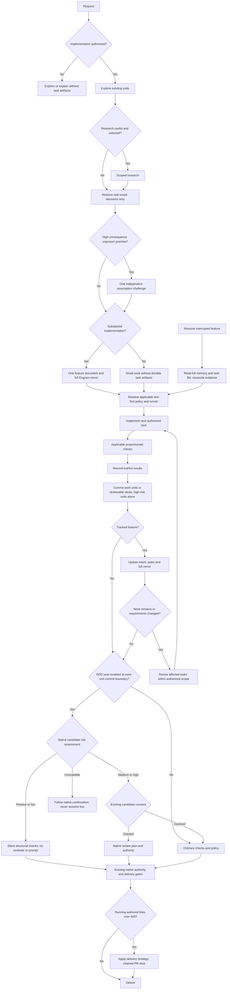

# ODD workflow fidelity and instruction organization

> **Status:** active
> **Owner:** Cipher 🔓 (Lead Orchestrator)
> **Created:** 2026-11-03
> **Objective:** Prepare the coordinated ODD adoption plan and its first implementation-ready workflow slice using available or separately approved tools; implementation remains execution-review gated.
> **Branch:** docs/odd/align-workflow-fidelity
> **Delivery:** ask-on-risk, stacked-to-main; first coherent source-contract slice forecast 372 authored additions plus deletions, generated files excluded; measured running count 303 for this work unit, below the strategy trigger. No publication authorized.
> **Runner:** `uv run --frozen python3 .opencode/skills/odd-workflow/scripts/validate_feature.py odd/tasks/2026-11-03-odd-workflow-fidelity.md`

Load and read the `odd-workflow` skill (`.opencode/skills/odd-workflow/SKILL.md`) before creating or maintaining this record. Its creation, delivery, change and closure procedures are canonical; this template illustrates their layout, not another policy definition.

## Specs

- S1 — The proposal accounts for every transition in the supplied ODD diagram together with its accompanying upstream prose. Exact requirement: "please this diagram is very important  is it defined on our project?" Acceptance: inspect the proposed mapping; each node and edge has a local owner, available capability or explicit unresolved gap, and normal/adverse verification scenario. The supplied diagram is preserved in L5.
- S2 — Tool equivalence targets strict behavioral fidelity without pretending unavailable Gentle AI commands exist. Exact requirement: "i want strict fidelity but i already know we cant follow it exactlu i said it for those tools that just are available on the real Gentle ai project it ahve its own tools that enforce it but i want u to try is strictly with the tools we have, u can propose to install new tools if needed". Acceptance: inspect each capability recommendation; available-tool evidence, limitations and approval requirements are explicit; native RDD is neither claimed nor enabled without evidence and authority.
- S3 — The proposal evaluates root organization and duplicated obligations without unapproved obligation loss. Exact requirement: "the  current agents.md file content need a review i think its not well organiized and i am worried about what is contains." Acceptance: compare identified originals with proposed owners; every valid obligation is retained, translated or proposed for explicit retirement with rationale, and approval-language conflicts are dispositioned.
- S4 — The proposal evaluates retiring separate profiles after migrating useful specialist behavior to each owning runtime and distinguishing globally shared behavior from coordinator identity and authority. Exact requirement: "if i am understanding well the actual profile files are more a problem than a benefit if u recommend we can dispose of them and move it to then own agent, and about cipher move that to root agents as a globall followup for all the agents". Acceptance: inspect the persona proposal; preserved behavior, retired duplication, exact consumers and distribution consequences are listed before deletion is authorized.
- S5 — Proposed shared behavior requires independent evidence-based judgment rather than pleasing agreement or automatic contrarianism. Exact requirement: "1 thing more i think in your behjavior should be added to be critical and not compliant always". Acceptance: walk through an unsupported premise and an already-supported authorized choice; the candidate challenges the former with evidence and proceeds with the latter without invented objections.
- S6 — Adoption reporting distinguishes written alignment, observed execution and unverified behavior. Exact requirement: "we have a file were we were tracking the adoption progress but seems like it is lying". Acceptance: inspect the proposed status treatment; documentary checks and observed scenario evidence are separate and no green validator is represented as autonomous compliance.
- S7 — The reusable bootstrap and synchronization tool remain complementary project responsibilities. Exact requirement: "this project is the owner of the tool and this project will be used in many other to ahve a strong base bootstrap." Acceptance: inspect the plan; reusable contracts remain neutral and destination-owned reconciliation is not performed here.
- S8 — Planning decisions use the question tool with explicit recommendations after accessible facts are investigated. Exact requirement: "PLEASE USE THE QUESTIONS TOOLS TO MAKE CHOICES AND DONT FORGET YOUR RECOMMENDATIONS. WHY U STOP ?" Acceptance: inspect the execution-review handoff; it supplies Issue → Goal → How → Files and a focused recommended choice, not an unsupported policy default.
- S9 — Authorization covers planning, the completed exact disposable probe and the approved first source-contract slice only. Approved option wording: "Coordinated plan (Recommended)"; initial authorization context: "This authorizes preparing the governing feature document—not implementation, installation, or destination changes." Later bounded approvals: "Run disposable probe (Recommended)" under L22, "Prepare first slice (Recommended)" under L30, and "Implement first slice (Recommended)" under L35. Acceptance: inspect changed paths and operations; source edits remain confined to L31 plus this record, with no installation, existing-memory mutation, further backend probe, persona deletion, publication or destination change. T6–T9 use current owner gates; later slices remain unauthorized.
- S10 — The proposed first slice makes the supplied flow operational in one canonical workflow owner while retaining the selected capability boundaries. Exact approved scope wording: "canonical diagram plus complete ODD flow rules, selected mirror/resume contract, decision-only stops and shared critical conduct." Acceptance: inspect the proposed workflow rules and scenario matrix; every L5 node/edge has an explicit disposition, optional native RDD remains disabled/unclaimed, and unavailable native continuation does not become invented delivery authority.

## Tasks

- T1 | S1, S2, S7 | delegated (saved-research reuse and current primary-source/tool capability assessment require the research owner) — Augur 🔮 (Research Analyst): identify an immutable upstream baseline; map diagram/prose requirements, memory/resume, RDD, tests and delivery to real local capabilities; return bounded evidence and installation options | open | commit: pending
- T2 | S3, S4, S5 | delegated (roster/persona changes require the roster owner; dependent on accepted T1 scope) — Marshal 🎖️ (HR Director): inventory exact runtime/profile/authoring consumers and propose behavior ownership; no edits or deletion | open | commit: pending
- T3 | S1, S2, S3, S6, S7, S8, S9 | inline (coordinator owns synthesis, decisions and the governing feature record) — Cipher 🔓 (Lead Orchestrator): join accepted evidence into exact phased changes, file lists, retained/translated/retired obligations, capability decisions and acceptance scenarios; present execution review before implementation | open | commit: pending
- T4 | S1, S3, S4, S5, S6, S9 | delegated (independent challenge of the plan and preservation accounting) — Sentinel 🛡️ (Quality Guardian): review in-scope instruction/feature proposals; report limits for research/configuration outside role scope | open | commit: pending
- T5 | S1, S2, S3, S4, S5, S6, S7, S8, S9 | inline (coordinator-owned structural validation and separate outcome acceptance) — Cipher 🔓 (Lead Orchestrator): validate the record, verify proposal coverage and current gates, and obtain scoped user decisions without claiming implementation delivery | open | commit: pending
- T6 | S1, S2, S3, S5, S9, S10 | delegated (approved first workflow slice; identified original inputs and accepted owner gate) — Scribe ✍️ (Docs & Problems Manager): author the exact L31 workflow/runtime/shared-rule changes and return an edit checkpoint before continuation | in progress | commit: pending
- T7 | S1, S2, S3, S9, S10 | delegated (ODD skill consumer alignment, proposed only; depends on accepted T6 owner review) — Scribe ✍️ (Docs & Problems Manager): align ODD skill/checklist to the accepted workflow owner, retaining unique record mechanics and original-obligation accounting | open | commit: pending
- T8 | S1, S2, S3, S5, S9, S10 | delegated (independent combined-candidate acceptance; proposed only) — Sentinel 🛡️ (Quality Guardian): audit applicable root/shared/workflow/record surfaces; Vault 🔐 (Catalog Steward) separately reviews skill scope; join does not substitute for either owner's gate | open | commit: pending
- T9 | S1, S2, S3, S5, S9, S10 | inline (coordinator outcome checks and evidence join, proposed only) — Cipher 🔓 (Lead Orchestrator): run scoped validators/manual walkthroughs, retain explicit runtime gaps and obtain release-owner commit evidence before any done transition | open | commit: pending

## Log

- L1 — Original request, verbatim:

> the  current agents.md file content need a review i think its not well organiized and i am worried about what is contains.
>
> and should we add this  G:\projects-personal\ai-core\agents\cipher\profile.md to opencode instructions it fells it is forgetting ho it shoul be its behaviour, and there sems to be duplicated things,
>
>  another thing agents.md have **Cipher owns:** but never mention Orgenic Driven development .
>
> and it seems this is not beinf followed as it is designed
>
> https://github.com/Gentleman-Programming/gentle-ai/blob/main/docs/usage.md#organic-driven-development-odd
>
> we have a file were we were tracking the adoption progress but seems like it is lying

- L2 — 2026-11-03 correction, verbatim: "please be critical and not compliant, explore the scope and make proposals"
- L3 — 2026-11-03 correction, verbatim:

> if i am understanding well the actual profile files are more a problem than a benefit if u recommend we can dispose of them and move it to then own agent, and about cipher move that to root agents as a globall followup for all the agents
>
> about P7 i am not sure if i understood but this project is the owner of the tool and this project will be used in many other to ahve a strong base bootstrap.
>
> i am interest on all your proposals, please make a double check on your analysys and then ask me using the question tool if u need desicions from me and please make me recommendations, be critical and not compliant.
>
> 1 thing more i think in your behjavior should be added to be critical and not compliant always

- L4 — 2026-11-03 correction, verbatim:

> hey i think u missed to analyse this here is all the workflow of organic driven development, there is a nice diagram
>
> https://github.com/Gentleman-Programming/gentle-ai/blob/main/docs/usage.md#organic-driven-development-odd
>
> analyze PLEASE and then start the questions

- L5 — 2026-11-03 clarification, verbatim:

> i want strict fidelity but i already know we cant follow it exactlu i said it for those tools that just are available on the real Gentle ai project it ahve its own tools that enforce it but i want u to try is strictly with the tools we have, u can propose to install new tools if needed, and please this diagram is very important  is it defined on our project?

- L6 — 2026-11-03 correction, verbatim: "PLEASE USE THE QUESTIONS TOOLS TO MAKE CHOICES AND DONT FORGET YOUR RECOMMENDATIONS. WHY U STOP ?"
- L7 — 2026-11-03 authorization: user selected "Coordinated plan (Recommended)" in the question tool. The displayed scope authorized preparing this governing feature document and a coordinated plan, not implementation, installation or destination changes. The earlier "Strict upstream fidelity" choice is qualified by L5; it does not mandate unavailable vendor tooling or authorize installation.
- L8 — Exploration evidence: current root, shared rules, workflow, ODD skill/checklist/template, profile, distribution clearance, adoption status and OpenCode V2 instruction/agent documentation were inspected. Upstream mutable `main` usage page was fetched; immutable baseline verification remains T1. Search of repository Markdown for `flowchart TD` and distinctive supplied labels found no operational copy of this diagram. This is bounded search evidence, not proof of execution behavior.
- L9 — Accepted independent challenge: Sentinel 🛡️ (Quality Guardian), instance sentinel-1, session `ses_e6021e38fffeLAZ1zv38N2MqGM`, read the root, shared rules, workflow, profile and its own runtime without writes. It corrected the write-only ODD claim, rejected zero-runtime-effect inference from a profile pointer, confirmed duplication with unique obligations to preserve, and identified the root's "only destructive/irreversible" approval wording conflict. Its verdict was UNCERTAIN about overall prior-analysis reliability, not feature acceptance. Prior unsupported causal, token, topic-count, version-bump and percentage claims were withdrawn in chat.
- L10 — Classification: non-small because workflow, role behavior, distribution consumers and verification semantics interact; risk is not contained to a simple edit and resumability requires a requirement/capability map. Bootstrap authority is L7. Current rules remain operative until separately approved changes; this record does not bypass the current mirror prohibition or execution-review pause.
- L11 — Candidate footprint to investigate, not an implementation write grant: `AGENTS.md`; `knowledge/agent-workflow.md`; `knowledge/agents.md`; `knowledge/release.md`; `.opencode/skills/odd-workflow/`; `odd/tasks/_template.md`; `.opencode/agents/`; `agents/`; persona-authoring consumers including `.opencode/skills/op-agent-creator/`; `opencode.jsonc` only if a concrete loading/tool capability requires it; `distribution-clearance.json`; `distribution-clearance.definition.md`; `README.md`; `PROJECT-STRUCTURE.md`; `docs/architecture/odd-adoption-status.md`. Exact paths, independent owner gates and original/candidate identities must precede any proposed implementation. No CI, dependency change, installation, publication or destination mutation is authorized here.
- L12 — Bootstrap checkpoint: only this record was authored. Next decision is authorization of read-only T1/T2 investigation and subsequent synthesis/review within the planning scope. No implementation task is included; later implementation requires an explicit plan revision and its existing execution-review gate.
- L13 — 2026-11-03 user selected "Proceed with investigation (Recommended)" in the execution-review question: bounded research, persona-consumer inventory, synthesis and independent challenge are authorized; only this record may be updated. Implementation, installation, deletion and destination changes remain unauthorized.
- L14 — T1 research return accepted as planning evidence, not completion or runtime verification: Augur 🔮 (Research Analyst), augur-1, session `ses_e60127588ffegW4P0gVfQ8bf7B`, pinned upstream `main` to `7d3528877d987765e4e5c504ed6049c3da7c4f4c` via HTTPS and compared its usage diagram/prose with current local owners. Full mirror is prohibited locally; native RDD is unverified; explicit testing, independent-challenge, delivery and high-risk isolation details remain partial. Upstream usage and review-integration documents disagree on size-triggered native review; resolve before any native-parity claim. Reported node/edge coverage is documentary; proposed normal/adverse scenarios were not executed. No writes/installations; resources released.
- L15 — 2026-11-03 additional user direction, verbatim: "AND PELASE AGAIN I GIVED U MANY TIMMES THIS USEFULL DOCUMENT READ IT TOO https://raw.githubusercontent.com/Gentleman-Programming/gentle-ai/refs/heads/main/docs/usage.md". Coordinator fetched that exact full page, including detailed prose and diagram. The pinned T1 baseline supplies the reproducible source identity.
- L16 — 2026-11-03 user selected "Full mirror contract (Recommended)": plan replacement of the prohibition with stable project/feature identity, full document plus locator, readback verification, conflict preservation and unavailable-backend recovery. Investigate existing Memories capability first; this authorizes no memory mutation, installation or policy implementation.
- L17 — 2026-11-03 user selected "Disabled, integration-ready (Recommended)": proposed native RDD remains disabled/unclaimed; preserve optional branch, consent/failure states and enablement prerequisites. Existing architecture/PR gates continue and are not relabeled native RDD.
- L18 — T2 roster return accepted as inventory evidence: Marshal 🎖️ (HR Director), marshal-1, session `ses_e600ffdb1ffeF55ekryIt6c1C3`, identified 17 profiles and 16 specialist runtimes, with root as coordinator runtime. Migration is currently forbidden by roster/creator rules and constrained by `.opencode/skills/core-sync/scripts/core_sync_pkg/tests/test_agent_sources.py`; dependencies also include creator reference examples, audit consumers and `.opencode/skills/core-sync/SKILL.md`. No full semantic audit of specialist bodies or scenario execution was claimed. Recommend translating useful specialist conduct into owning runtimes, sharing conduct without coordinator authority, and preserving historical records. Source deletion does not prove destination deletion or reconciliation. All reads ceased; resources released. T1/T2 remain uncommitted planning evidence, not done task rows.
- L19 — 2026-11-03 user selected "Consolidate, scoped roles (Recommended)": proposal puts shared critical/calm/clear conduct in root, useful specialist conduct in owning runtimes and coordinator identity/authority in an explicitly scoped section. Profile retirement requires preservation review and coordinated consumer/test updates; no deletion is authorized by this choice.
- L20 — 2026-11-03 user selected "Decision-only stops (Recommended)": proposal removes universal post-creation/material-replanning approval stops for already-authorized settled work, preserving genuine scope/authority, destructive-action, installation and release boundaries. Current pause remains operative until approved implementation changes it.
- L21 — T1 mirror-feasibility supplement accepted as source-based planning evidence: Augur 🔮 (Research Analyst), augur-mirror-1, session `ses_e600bfd8bffeCgtK2AI7e9lU1l`, inspected versioned publisher package `https://unpkg.com/@memories.sh/cli@0.7.9/dist/index.js` and `dist/chunk-WQX5ZEZ2.js`, registry metadata and current tool docs. Source supports untruncated application-level content storage/read formatting; exposed operations lack exact feature-key lookup/upsert, explicit read-scope selector and compare-and-swap. Actual server revision/scope, transport truncation, persistence and full round-trip remain unverified. Current docs describe newer selectors not present in exposed schemas. Recommend a serialized disposable synthetic-note add/read/edit/read/forget probe before any backend installation; current approval does not permit it. No memory calls or mutations occurred; resources released.
- L22 — 2026-11-03 user selected "Run disposable probe (Recommended)": explicit exception authorizes one synthetic note, project `github.com-personal/JPerezC92/ai-core`, unique marker, retrieval/update/readback and soft-delete only its returned ID; no existing-memory mutation, vacuum or installation. Synthetic test data is not durable workflow knowledge. This later bounded permission supersedes L21's no-probe state only for that probe.
- L23 — Probe execution by coordinator: `memories_add_memory` with type note, marker/tag `ODDMIRRORPROBE20261103CIPHER7D352887`, explicit project above, synthetic locator, revision 1 and beginning/middle/end sentinels returned ID `sGVqoro6HIvt` and confirmed project. `memories_list_memories(limit=2,tags=[marker],types=[note])` and `memories_search_memories(query=marker,limit=2,types=[note])` each returned that single project-scoped ID with complete visibly expected payload (Markdown, quotes, backslashes, Unicode, table and code fences). `memories_edit_memory(id=sGVqoro6HIvt,content=revision-2-payload,metadata=revision-2)` changed the revision and appended a synthetic Log line; independent search returned the same ID, revision 2, added line and all sentinels. `memories_forget_memory(id=sGVqoro6HIvt)` confirmed cleanup; final marker search returned "No memories found matching your query." Storage warnings suggested vacuum; none was run. No real feature mirror or other memory was written. This was tool-visible content comparison, not a mechanical byte/hash comparison, maximum-size, concurrent-writer or restart-persistence test. Soft-deleted probe residue remains by design. Recommend existing backend first, with acceptance limits outstanding.
- L24 — T3 proposed staged implementation, not approval: (A) place one canonical diagram and accompanying operational transition rules in `knowledge/agent-workflow.md`, distinguish vendor-native labels from available capabilities, define optional bounded independent challenge, proportionate reporting and decision-only stops; (B) replace mirror prohibition in root/workflow/ODD skill/checklist with a serialized full-document+locator procedure, explicit identity/readback/conflict/pending-recovery controls and project-owned backend binding; (C) complete behavior-test, handoff/verifier, high-risk commit isolation and delivery-strategy contracts in their existing workflow/skill/release owners; (D) migrate useful specialist persona into each runtime, shared critical conduct into root and coordinator authority into a scoped section, update creator/auditor consumers and source-contract tests before profile retirement; (E) replace misleading adoption conclusions with source-pinned documentary mapping plus separately dated observed scenario evidence. Native RDD stays disabled/unclaimed; no vendor transition command is fabricated, and existing gates remain until individually dispositioned. CI is not included in this proposal.
- L25 — Diagram coverage assignment for the proposal: A–D and J/L use authorization/exploration/classification rules; E/F/G optional research and decisions; H/I explicit at-most-one independent high-consequence challenge; K/T/X full mirror create/update/reconcile and unavailable recovery; TT/M/N/Q runner/test-first/functional checks/truthful evidence; QC/R/U/V work-unit evidence and affected-only continuation; O/AB/Y ordinary route plus existing authority when RDD disabled; P/AC/AD/AE/AF document disabled native branch, consent and unresolved unavailable continuation without inventing an AE→delivery edge; AG/AH/S strategy choices and delivery boundaries. Source prose controls before-next-commit strategy timing. Required acceptance probes: read-only/no artifact; small/no artifact; substantial create/readback; requested-rule RED/GREEN and touched-command before/after checks; changed-intent affected-only reopen; interrupted/stale/conflicting/unavailable mirror recovery; isolated high-risk commit; chosen chain strategy; disabled RDD/no ceremony; unsupported premise/one challenge; supported choice/no manufactured objection. None of these full-workflow probes has run in this planning slice.
- L26 — Planning preservation boundary: retain all valid role identities, ownership, evidence, safety and release gates; translate duplicated shared conduct and workflow law into single owners; propose retirement of decorative profile duplication, standalone profile packaging and automatic plan pauses only under selected scope. Exact clause-level original→candidate accounting and identities remain implementation prerequisites, not established by this summary. New backend installation or local RDD implementation requires its own proposal and approval. Full-feature acceptance/closure and task commits remain pending.
- L27 — Independent planning review: Sentinel 🛡️ (Quality Guardian), sentinel-plan-1, session `ses_e60052072ffeBY9XGHvT1z7gsl`, returned FAIL with one finding: S9 retained its original record-only constraint without incorporating the later expressly authorized disposable probe. Corrected S9 to include only that bounded exception, preserving other prohibitions. Review found the proposal substantive and evidence limits explicit; exact implementation-phase files/originals/gates/checks remain prerequisites. No implementation or whole-feature acceptance is claimed. Re-review pending.
- L28 — Planning re-review accepted: same independent reviewer freshly read the full corrected record through L27 and returned PASS, zero open findings, for planning-proposal scope only. S9 correction verified; no implementation, vendor/runtime fidelity or whole-feature completion certified. Coordinator then ran the literal Runner: exit 0, `ok odd/tasks/2026-11-03-odd-workflow-fidelity.md`. Task commits and whole-feature acceptance remain pending; planning outputs are not represented as done task rows.
- L29 — 2026-11-03 user selected "Ask-on-risk, sequential (Recommended)": proposed implementation delivery uses ask-on-risk with stacked-to-main, coherent sequential reviewed slices and refreshed evidence after merges. Concrete chain presentation occurs once when needed; push/PR/merge remain separately authorized. This updates the proposal only, not the current planning-slice header strategy or release authority.
- L30 — 2026-11-03 user selected "Prepare first slice (Recommended)": authorized expanding this record into exact first-slice tasks, preservation/check/gate packet and execution-review presentation only. Source implementation remains unauthorized until that review. S9 is updated prospectively rather than leaving the original planning-only promise in conflict with later scope history.
- L31 — First-slice exact proposed authored sources: `AGENTS.md` (scope coordinator-only identity/authority explicitly; add shared evidence-based critical conduct; expand Organic Driven Development ownership; replace misleading first-write framing; correct "only destructive/irreversible" wording; move selected pause rule to decision-only stops; replace cache-only/no-mirror restrictions with the approved full-mirror contract and project-owned Memories binding while retaining unrelated memory discipline); `knowledge/agent-workflow.md` (canonical diagram and operational rules, named optional research/challenge branch, automatic authorized continuation, mirror create/update/readback/resume/conflict/unavailable recovery, conditional test/runner and per-spec verifier rules, optional native RDD disabled/unclaimed boundary, delivery strategy pointer without fabricated vendor commands); `knowledge/agents.md` (reconcile shared evidence/no-memory-only discipline with repository-authoritative full mirror, reference root conduct rather than duplicate it, reconcile pause/reporting references if present); `.opencode/skills/odd-workflow/SKILL.md` and `references/_checklist.md` (replace explicit no-mirror and automatic-pause prohibitions with pointers to the new owner, retain unique record create/update/close/validate mechanics); this governing record. `odd/tasks/_template.md` remains unchanged unless an identified mandatory field mismatch requires a returned scope decision; no mismatch is currently established. No other source path is authorized by this proposed slice.
- L32 — Preservation packet to produce before authoring: identify current originals by hashes; enumerate each touched original obligation in root workflow/pause/memory sections, shared memory/reporting references and skill/checklist prohibitions; retain valid authorization, safety, independence, evidence, semantic closure and release constraints; translate duplicated flow/presentation rules into exact owners; retire only selected automatic-pause and no-mirror/cache-only exclusions with user choices L16/L20 as authority. New mirror semantics require full content plus locator, stable verified project/feature identity, one serialized writer, ID validation before edit, independent readback, preservation of divergent versions before replacement, explicit pending recovery and no unsupported cache-only substitution. Do not invent an exact lookup/upsert or atomicity. User-selected RDD state L17 forbids installation/enabling or native-equivalence claims. Persona separation rules stay until their later slice.
- L33 — First-slice checks/gates: coordinator runs literal feature validator and existing Markdown text-integrity checker against exact changed paths after confirming current checker contract; no application/test code changes, so no invented RED test or whole-suite run. Prose manual walkthroughs use L25 scenarios with expected transitions: unauthorized/read-only and small routes create no tracker; already-authorized settled work continues without blanket pause; independent challenge occurs at most once for a high-consequence premise; mirror conflict/unavailability preserves intent and reports pending rather than inventing success; disabled RDD uses ordinary gates without ceremony; touched-command behavioral tests and high-risk isolation are required where applicable, never claimed executed for this prose slice. Sentinel reviews its in-scope authored documents; Vault reviews changed skill/checklist contract and any scope it owns; receive parent-visible checkpoints and accept current verdicts before dependent authoring. Exact original/candidate obligation accounting precedes combined acceptance. Current tiny synthetic probe is bounded evidence only: large-document/full-feature/restart/concurrent-writer validation remains pending and is not silently authorized by this source-edit proposal. No real feature mirror or further backend mutation is included without a separate bounded runtime-probe approval. Source-contract delivery and observed backend adoption must remain separate statuses.
- L34 — Delivery readiness: first implementation-slice authored-line forecast is not yet measured; after obligation inventory, forecast before authoring and use selected ask-on-risk/stacked-to-main policy if the coherent slice requires chaining. Do not force a cosmetic split or authorize publication from that strategy. Git remains with Herald 📯 (Release Manager); current worktree/branch and user changes must be inventoried by that owner before implementation, with no base-branch commits. No push/PR/merge is authorized. Source-slice completion does not close the broader coordinated feature or certify later persona/delivery/adoption slices. Execution-review pause is required now because current instructions remain operative.
- L35 — 2026-11-03 user selected "Implement first slice (Recommended)": exact L31 source edits and L33 scoped checks authorized, with preservation inventory, branch/forecast preflight, parent-visible checkpoints and independent reviews. Additional scope returns to user; no further memory mutation, persona retirement, installation or publication. Herald 📯 (Release Manager) preflight found only this untracked record on main HEAD `0a38b37de8c22e97595ae145ef9da109a022d94f`, then created `docs/odd/align-workflow-fidelity` at that unchanged HEAD without staging/commit or other changes; operations/resources released. S9 updated to current authority.
- L36 — Coordinator original SHA256 identities, `Get-FileHash -Algorithm SHA256 -Path AGENTS.md,knowledge/agent-workflow.md,knowledge/agents.md,.opencode/skills/odd-workflow/SKILL.md,.opencode/skills/odd-workflow/references/_checklist.md`: respectively `B9F3712BF036E096ED1E0127858C91887D1B03882F5CDD97AA9A10EBCA79F954`, `9433001FABB46CF0078766018F5930886BAA36B37395D89D5C677C39A32EF7C0`, `961F6122174EE77E770C604274198F95C4B88D3E40D6E72324B94D23E95642A0`, `52C6C46324E6752E7257BA81A8459BF40C893572339BCD971B0E67D114526B14`, `8161A60B8DD2A2B05F96BCABF2C75FD5076B1B41E077267E718995D29449056E`. These identify source inputs, not reviewed candidate output.
- L37 — Accepted original-obligation inventory from Scribe ✍️ (Docs & Problems Manager), scribe-inventory-1, session `ses_e5ff6fbe1ffeQSbWI3wGZCV6tQ`: ROOT identity/profile/root-runtime, all role ownership/delegation/architecture/PR/standards duties and prohibitions retained; coordinator identity explicitly scoped, workflow named for every request; final authority bounded by all approval rules, retiring misleading "only" exclusion; backend pins/database/limitations moved into project binding, while repository authority/no-memory-only durable knowledge/replaceability, bounded retrieval, source verification and stale-index caveats remain; session cache separated from full mirror; reporting/continuation/bootstrap/file-list rules retained, universal creation/replan stop and same-turn ban retired only under L20; all other root obligations unchanged, including persona separation pending later slice. WORKFLOW authorization, proportionate exploration, uncertainty/outcome, genuine decision routing, three-test classification, artifact-free paths, sole bootstrap/no-retroactive tracking, scope readiness, dependency/concurrency, tests/docs/conditional RED and no invented runner/harness, owner gates, commit/evidence reporting, loops, separate outcome/failure reproduction/semantic close, step-state/compact/checkpoint/static-permission rules retained; only blanket automatic-pause and no-mirror/cache-only exclusions replaced by L16/L20; named-path/reuse/full-read/missing-pointer/template/record mechanics/navigation/release/extraction/conflict/architecture/clearance/history obligations retained. SHARED project-scoped subordinate retrieval, source validation, miss limitations, no-memory-only durable knowledge, authorized writes and all other evidence/coordination/architecture/incident/release rules retained; full mirror distinguished from cache and root conduct referenced, not redefined. SKILL/CHECKLIST lifecycle/no-competing-tracker/no-context-injector retained; mirror ban and automatic-pause references translated to workflow/root owners; date/header/template/behavioral-verbatim Specs/task-route-status-commit/Log fidelity, forecast/advisory distinction, affected-only reopen, runner/provenance/scenario/accounting, independent semantic/remediation/loop/closure, handoff/shared-scope/delivery/release/anatomy-only checks and no-transcript obligations retained unchanged. Candidate-to-original verification remains pending; this inventory is not self-certification of preservation.
- L38 — First-slice forecast accepted as planning estimate, not measured diff: root +42/−18; workflow +128/−22; shared +6/−1; skill +8/−3; checklist +6/−2; feature record +30/−6 = 372 authored additions plus deletions. Diagram/transition prose dominates; reforecast if expanded accounting changes budget; no cosmetic compression. Coherent owner→review→consumer→combined-review source-contract slice recommended; no inconsistent intermediate contract delivered. Source version policy for edited root/skill requires explicit disposition before delivery; unchanged agent runtime versions stay untouched. Pre-authoring inventory and approval are now established; source author returns checkpoint before continuation.
- L39 — T6 owner edits authored by scribe-author-1 in the three exact owner paths; parent checkpoint returned and resources released. Original source copies were preserved under gitignored output, but Sentinel's hard-out excludes auditing output. Coordinator copied identical untransformed source inputs to `C:/Users/dexm7/AppData/Local/Temp/opencode/odd-fidelity-originals/{root/AGENTS.md,knowledge/agent-workflow.md,knowledge/agents.md}`; measured SHA256 equals L36. Reviewer then read these actual originals, not an author summary. These temporary copies supplement, never replace, repository/Git preservation evidence.
- L40 — T6 owner review round 1 FAIL, sentinel-owner-1: F1 root heading rename violated existing SP-1; F2 root version classification unresolved. Coordinator freshly read `.opencode/agents/sentinel.md:142,157–160`: retain `Identity & Role` plus scope paragraph; incompatible retirement of mandatory approval boundary requires major version. Scribe corrected only root to restore heading and set Spec version 4.0.0. Coordinator additionally required concrete upstream Tests/Handoffs details (per-rule RED, same changed-input old/current stdout/stderr/exit, touched-command regression coverage, shared-state helper reuse, help/docs, full-feature/per-spec verifier), which Scribe added in the existing behavioral verification owner. No runtime-test failure or source execution was claimed.
- L41 — T6 owner review round 2 PASS, zero open findings: Sentinel independently compared actual originals with candidate root SHA256 `5BA9CE842E8A689A4430790BE208F514A1907459172BC9EE0C1969D6C2B4DA6F`, workflow `4829362E74C0FF2C7EB1AC7BD9197F4FA0C5FBE69BF9376DE43CAD077CB8BBE4`, shared `6064D49DDC7496DE4AFE7F7CA0D7444A8B40C8F8FFAD3A2927693C029C58D451`. F1/F2 fixed in round 2; all valid original owner obligations retained or translated except explicitly selected no-mirror/blanket-pause exclusions and conflicting "only" wording. Role/delegation, safety, evidence, coordination, architecture, reporting, bootstrap, records, semantic-close and release rules retained; backend bindings translated to project; mirror procedure to workflow. No additional obligation loss found. L37 long-line tool truncation was disclosed; verdict grounds on actual full originals, not unseen inventory text. Owner-only gate accepted, T7/combined/runtime acceptance still pending. No third remediation round authorized or needed for this owner gate.
- L42 — T7 consumer checkpoint authored: skill `79983B7E863EEBA9AA1A3CBE221112327184A182613715A5009C2DE1B548CE94` version 2.0.0, checklist `BA085F8240ED276C5EB695899D33107B9FC3AEBA5906C2A6DC31725ED52C5793`; originals at `C:/Users/dexm7/AppData/Local/Temp/opencode/odd-fidelity-originals/skill/` re-measured equal to L36. T8 gates: Vault 🔐 (Catalog Steward) PASS for changed-skill source contract, Template C, zero open findings, complete skill/checklist accounting, version advance justified, no registry update required; Sentinel combined PASS for reviewed source-contract scope, zero open findings, prior F1/F2 still fixed, consumer conflicts removed. Sentinel recorded S4 not applicable to this slice, S6 deferred outside slice, and did not certify vendor-prose completeness or runtime adoption.
- L43 — Coordinator outcome checks, executed: `uv run --frozen python3 .opencode/skills/odd-workflow/scripts/validate_feature.py odd/tasks/2026-11-03-odd-workflow-fidelity.md` → `ok`; `uv run --frozen python3 .opencode/skills/op-skill-creator/scripts/check_markdown_text.py --policy knowledge/unicode-policy.json` over `AGENTS.md`, `knowledge/agent-workflow.md`, `knowledge/agents.md`, ODD skill/checklist and this record → exit 0, no diagnostics; supplied-diagram versus canonical-diagram extraction comparison → exact text match; targeted cross-reference check → all 14 owner/skill dependencies resolve (one initial apparent miss was a coordinator em-dash transcription artifact, confirmed correct by direct heading read); `git diff --numstat` → root +18/−10, workflow +87/−6, shared +3/−1, skill +8/−3, checklist +7/−2, new record +158 = 303 authored additions plus deletions against the 372 forecast, below the strategy trigger. Textual walkthroughs, not runtime execution: decision-only stops present in `AGENTS.md`; single independent-challenge limit present; mirror conflict/unavailability preserves repository authority and reports pending recovery; native RDD disabled/unclaimed with no inferred unavailable→delivery edge; persona separation still referenced pending the later slice; architecture/PR/release/semantic gates retained.
- L44 — Full-mirror status for this record: **pending recovery, not synchronized.** Root project extension forbids real backend writes in this source slice, so this record's mirror has not been created. Verified backend identity is unavailable; repository content remains authoritative. Next bounded action if approved: run the L22-style create/readback procedure for this record with its real project/feature identity, then record backend ID, verified revision and comparison method. Source-policy verification is not mirror-adoption evidence.
